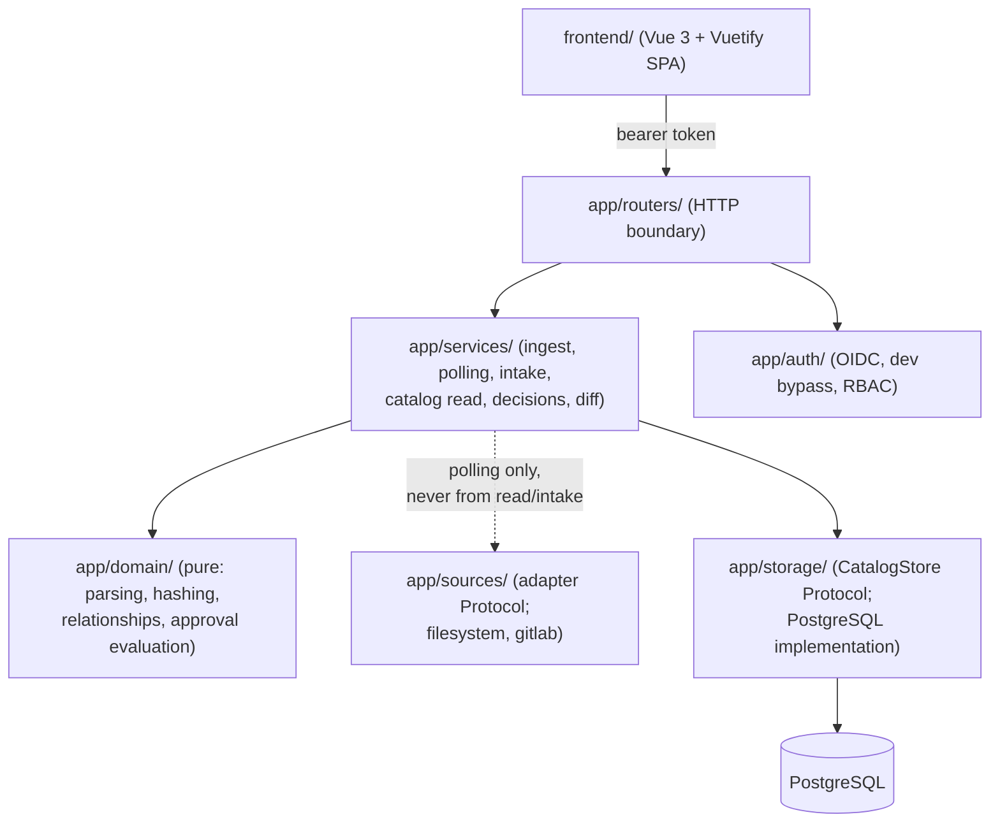
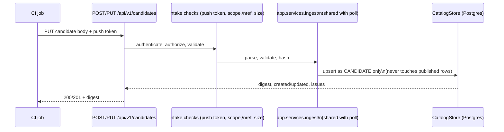
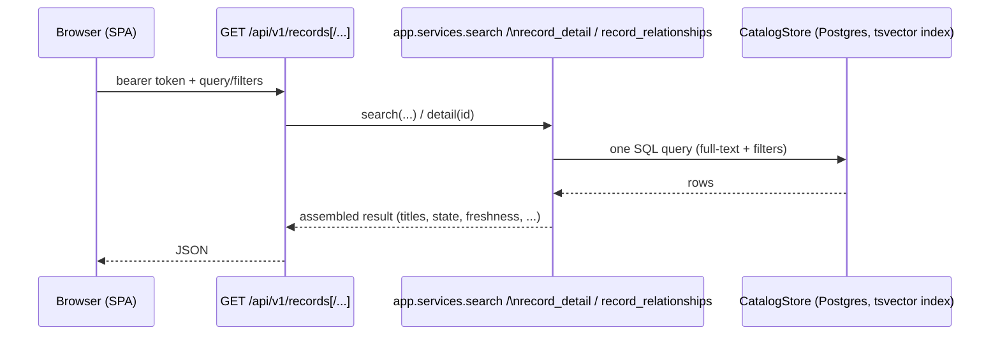

# Architecture

Audience: architects evaluating the system's shape and the forces
behind it. Dated: written during Phase 1 delivery, 2026-10-19 (see
`phases/DECISIONS.md`, confirmed with the product owner the same
day). See `docs/operator.md` for how to run it and `docs/schema.md` /
`docs/approval.md` for the domain model this serves.

## Concern map

One module (or small module group) per concern, with calls flowing
only downward (`phases/DECISIONS.md` "Repository layout"):



Normal browse/search/detail requests only ever reach `Services ->
Storage -> DB`; they never construct or call a source adapter
(enforced by a dedicated test, acceptance criterion 5). Source
adapters are called from exactly one place: the polling service.

## Data flow: poll path

```mermaid
sequenceDiagram
    participant Cron as cron / CronJob / operator
    participant CLI as adriano poll (or POST /sources/poll)
    participant Poll as PollingService
    participant Src as Source adapter (filesystem/gitlab)
    participant Store as CatalogStore (Postgres)

    Cron->>CLI: trigger
    CLI->>Poll: poll_all() / poll_source(id)
    Poll->>Store: start intake_run; take advisory lock
    Poll->>Src: list_projects(), list_documents()
    Src-->>Poll: project/document listing + change tokens
    Poll->>Src: fetch() changed documents only
    Src-->>Poll: raw bytes + source_url + author
    Poll->>Poll: parse, validate, hash\n(app.domain, shared with push)
    Poll->>Store: upsert published rows; reconcile deletions\n(only if the listing was complete)
    Poll->>Store: finish intake_run (ok/partial/failed)
```

An incomplete or failed listing deletes nothing (acceptance criteria
10, 11): the poll records `partial`/`failed` and prior content stays
available.

## Data flow: push path (CI)



Push intake never calls a source adapter and can never write a
published row for the same ADR identity (acceptance criterion 12) --
the same `prepare_document`/`ingest_document` functions used by
polling guarantee both paths parse, validate, hash, and persist
identically (acceptance criterion 8).

## Data flow: read path



Every read is a single round trip to PostgreSQL; nothing here ever
reaches a source.

## Storage choice and concurrency

**PostgreSQL, via psycopg3 + SQLAlchemy 2 + Alembic**, chosen over a
separate search engine or a document store:

- Full-text search needs are met by a weighted `tsvector` column with
  a GIN index (title weighted highest, then uuid/project/path, then
  body) -- adequate for the catalog's scale (thousands, not millions,
  of ADRs) without running a second stateful service.
- The domain never depends on PostgreSQL directly: `app.storage.port`
  defines an abstract `CatalogStore`/`CatalogStoreProvider` Protocol;
  `app.storage.postgres` is the only implementation, so a future
  implementation swap would not touch `app.services` or
  `app.domain`.
- **Concurrency:** writes for one source registration take
  `pg_advisory_xact_lock(hash(source_id))` so two pollers (or a poll
  racing a push) for the same registration serialize instead of
  interleaving; upserts use `ON CONFLICT`; decision races resolve via
  a unique constraint (`409` on the loser, never a silent overwrite).
  See `docs/operator.md` "Multi-replica notes".
- **Multiple replicas:** `backend` is stateless and share-nothing
  (module-twelve-factor); any number of replicas can run against the
  same database. `migrate` runs exactly once per deployment, before
  any replica of the new version starts (see `docs/operator.md`
  "Migrations").
- **Backup/restore/durable audit history:** standard `pg_dump` /
  `pg_restore` (see `docs/operator.md` "Backup and restore");
  `decision_event` is append-only (DB trigger) and, together with
  `revision`, is retained indefinitely as the audit trail (see
  `docs/operator.md` "Retention" and the tamper-evidence limits in
  `docs/hashing.md`).

## Why no queue, search cluster, or microservices

None of these are justified by Phase 1's actual load or requirements
(`phases/SPEC.md` "Architecture and persistence" explicitly asks to
avoid them without a demonstrated need):

- **No distributed queue/event bus.** Polling is a periodic,
  idempotent batch operation (one registration at a time, serialized
  by the advisory lock); a queue would add an operational dependency
  without solving a problem this workload has. The one-shot CLI/cron
  model is simpler to run, debug, and reason about.
- **No separate search cluster.** PostgreSQL's `tsvector` is expected
  to meet the P95 target at the catalog's expected scale (measured in
  `docs/benchmark.md`, phase 09); running Elasticsearch/OpenSearch
  alongside
  Postgres would double the stateful services to operate and back up
  for no measured benefit.
- **No microservices.** The concern map above already separates
  parsing, sources, polling/intake, persistence, and the web layer by
  module boundary, which is enough isolation for a single team to
  reason about and test independently; splitting these into network
  services would add latency, deployment complexity, and failure
  modes (partial outages, versioning across services) with no
  corresponding benefit at this scale.

## Deviations

- **`filesystem` source type.** `phases/SPEC.md` requires `gitlab` as
  a source type; `filesystem` (reading ADRs from a local directory
  tree) is **not** in the original spec. It was explicitly authorized
  by the product owner as a deviation (`phases/DECISIONS.md` "Source
  types in Phase 1") so the product can be demonstrated end-to-end
  (including this repository's `samples/adr-root/` and `task demo`)
  without standing up a real GitLab instance. It shares the same
  adapter Protocol as `gitlab`, so no other layer treats it
  differently.
- **Container `HEALTHCHECK` stanzas.** See `docs/operator.md` "Health
  checks" for why this project adds them despite the deployment stack
  kit's "opt-in only" default -- `phases/SPEC.md` acceptance criterion
  27 requires documented container health checks.
