# Phase 1 demo walk-through

Audience: product owner and new users. This page walks through the
containerised demo stack screen by screen, so you can see what adriano
does without reading any code. Every step names the Phase 1 acceptance
criteria (see `phases/SPEC.md` "Phase 1 acceptance criteria") that it
demonstrates, in the form `(AC n)`.

## Reproduce it yourself

```sh
task demo       # build + start the stack, poll, print sign-in help
task demo:ui    # in a second terminal: dev-login UI on :5180
task demo:down  # stop and discard the stack when you are done
```

`task demo` builds the containers, starts PostgreSQL, the backend, and
the frontend (a production build with no dev-login UI, published on
<http://localhost:8180>), generates a gitignored `.env.demo` with a
random dev-auth secret and CI push token, and runs the first poll of
`samples/adr-root/`. `task demo:ui` runs a second, interactive
frontend (a Vite dev server with dev sign-in enabled) on
<http://localhost:5180>, proxying to the same backend, which is what
every screenshot below was taken from. Candidates are pushed with
`samples/push-candidate.sh` (see step 5).

Three identities are used throughout. The dev sign-in presets are
derived from the loaded catalog's `rbac`/`approval_policy` roles
(`catalog.demo.yaml`, via the dev-only `GET /auth/dev/roles`): the
dev sign-in dialog's own preset buttons are labelled "Reader",
"Reviewer" and "Operator" (not "Admin" — that is only the underlying
role name a catalog happens to grant `operate` through) and come
straight from that catalog, so a differently configured deployment
offers different presets, or none, instead of a fixed list.

| Role preset | Roles granted | Can read | Can decide | Can poll |
|---|---|---|---|---|
| Reader | `reader` | yes | no | no |
| Reviewer | `adr-reviewer` | yes | yes (listed in the policy) | no |
| Operator | `admin` | yes | no (not a reviewer) | yes |

## 1. Search the catalog (AC 1, 2, 4, 5)

A clean `task demo` start indexes 14 sample decision records (plus 2
published errata, hidden from the default "Decisions" filter — see
step 14) on the first poll. The landing page's search field is the
primary control, with source/project filters, a published/candidate
toggle, a "Show" select (Decisions/Errata/Both), a "Sort by" select
(Relevance only once a query is set, Title A–Z by default, or
Recently changed), and a "Needs approval" switch — every filter and
the sort order live in the URL, so a search is shareable and
restorable with back/forward. Browsing here never calls a source
(GitLab or the filesystem root); it only reads what the last poll or
push already indexed. A status chip is shown only when it differs
from the default: a plain published decision shows no chip at all,
and "Pending approval" is neutral text, not a strong colour — colour
is reserved for issues and rejections. The backend-status chip in the
top-right only appears when the backend is degraded or offline; a
healthy backend (the normal case) shows no chip at all.

The screenshot below also includes the three candidates pushed in
step 5 (they were pushed ahead of this screenshot for this
walk-through's convenience), so it shows 17 decision rows rather than
14.


## 2. Filter by project and state (AC 2, 4)

Selecting `central` / `platform` and the "Published" toggle narrows
the catalog to 8 platform decision records; a closable chip appears
under the filter bar for each active filter ("Source: central",
"Project: platform", "State: Published"), the result count states
how many filters are active, and "Clear filters" removes them all at
once. Two records are flagged "Blocked" (a neutral status, not a
colour-only warning) because they have no valid UUID to decide
against; every other record shows "Pending approval" as plain text,
since nothing in this filtered view has been decided yet.


## 3. A legacy record (AC 14, 15, 24)

Opening "Retire the legacy invoicing processor integration" shows a
file written before the current schema existed: it uses the legacy
`deprecates` field (reported as a `legacy_alias` warning, with
"use `obsoletes` instead") and a legacy `signed-off-by` list, shown
under "Legacy sign-off (unverified)" with an explicit note that it is
historical, unauthenticated text and does not satisfy the approval
policy. The `deprecates` link itself still resolves and is navigable,
to "Use Stripe for card payment processing". The record page follows
the rfc-editor.org/info layout: status banners at the top, the
document as the main column, and an "About this decision" sidebar on
the right whose first card holds the status chip and — for an
eligible reviewer — the Accept/Reject buttons, within reach without
scrolling.


## 4. An isolated invalid record (AC 3, 23)

"Broken YAML frontmatter" has an unterminated quoted string in its
`title` line. The catalog stores it anyway, keyed by its file
location (no UUID can be read), and reports one `bad_yaml` error with
the exact parser message and line number. Because no identity can be
established, the sidebar's status reads the neutral "Blocked" (never
a disabled, unexplained Accept/Reject pair), with "This content can't
be decided until its problems are fixed." as the reason. Every other
record stayed fully browsable the whole time — step 1's search
results list is the same 14 decision records (candidates arrive
later, in step 5), with only this one flagged.


## 5. A candidate arrives via CI push (AC 7, 8, 12)

A CI job (or a developer, locally) pushes a candidate on a feature
branch with the same parse/validate/hash/persist pipeline polling
uses. Push never touches a published record: a candidate for an
existing ADR UUID is stored as its own row, never overwriting the
published one.

```text
$ export ADRIANO_PUSH_TOKEN_CENTRAL=$(grep ADRIANO_PUSH_TOKEN_CENTRAL .env.demo | cut -d= -f2)
$ export ADRIANO_API_BASE_URL=http://localhost:8180

$ samples/push-candidate.sh \
    samples/candidates/2026-01-05-use-redis-for-caching.md \
    platform feature/redis-cache
PUT http://localhost:8180/api/v1/candidates (source=central project=platform ref=feature/redis-cache uuid=b87a5fc5-a48f-49cb-a029-ac1f7c56c717)
{"record_id":"4ae6fbfc-...","digest":"sha256-v1:1d6a69130da9...","created":true,"updated":false,"deduplicated":false,"issues":[],"catalog_path":"/records/4ae6fbfc-..."}

$ samples/push-candidate.sh \
    samples/candidates/2026-01-10-adopt-kafka-for-events.md \
    platform feature/kafka-events
PUT http://localhost:8180/api/v1/candidates (source=central project=platform ref=feature/kafka-events uuid=6b1b7968-e918-497b-ab90-5287af582744)
{"record_id":"6d82b40b-...","digest":"sha256-v1:5403f9a9a90a...","created":true,"updated":false,"deduplicated":false,"issues":[],"catalog_path":"/records/6d82b40b-..."}

$ samples/push-candidate.sh \
    samples/candidates/2026-01-15-add-circuit-breakers.md \
    platform feature/circuit-breakers
PUT http://localhost:8180/api/v1/candidates (source=central project=platform ref=feature/circuit-breakers uuid=3f5e1b69-f3bf-4fb4-b173-ccfa92d8baab)
{"record_id":"655cfe3d-...","digest":"sha256-v1:8620e6362067...","created":true,"updated":false,"deduplicated":false,"issues":[],"catalog_path":"/records/655cfe3d-..."}
```

Searching for "Redis" now shows the pushed file as a distinct
candidate row: the branch appears once, as plain secondary text next
to the source/project line ("Branch: feature/redis-cache"), with a
small "Candidate" chip and "Pending approval" as neutral text beside
it. A query also switches "Sort by" to "Relevance" by default.


## 6. A reviewer accepts the candidate (AC 16, 22, 26)

Signed in as Bob (role `adr-reviewer`, listed in the configured
`global` policy), opening the Redis candidate offers Accept/Reject
both in the sidebar's first card and in the main column's Approval
card. Accepting asks for explicit confirmation of the **exact
digest** being decided, so a reviewer is never approving "whatever is
there now"; the dialog's own heading names the record (`Accept “Use
Redis for application-level caching”?`), and the digest is shown
short, with a copy button and a "Show full digest" disclosure:


After confirming, the record shows "Accepted — candidate" in the
sidebar: the decision is recorded for this content hash before the
change is ever published, so implementation can start from the
accepted candidate.


## 7. Identical-content promotion (AC 13, 17)

Copying the exact same file into the filesystem source's published
tree and polling again promotes the accepted candidate automatically:
the published row is accepted too, with the **same digest** and the
**same decision history** — nothing is re-reviewed or re-copied,
because acceptance is keyed by (identity, content digest), not by
which ref the content happened to live on.

```text
$ cp samples/candidates/2026-01-05-use-redis-for-caching.md \
    samples/adr-root/platform/doc/decisions/
$ task demo:poll
docker compose exec backend adriano poll
INFO app.services.polling: poll central finished: ok PollCounts(projects=3, documents=17, unchanged=16, fetched=1, created=1, updated=0, same_content=0, tokens_refreshed=0, deleted=0, skipped_owned=0, failed=0)
central: ok (projects 3, documents 17, fetched 1, unchanged 16, created 1, updated 0, deleted 0, failed 0)
```


## 8. Editing breaks acceptance; the diff shows why (AC 18, 20)

Editing the published file's content (even a single sentence) and
polling again changes its digest. The old acceptance stays in
history, but it no longer covers the new current content, so the
record flips to "Changed since acceptance" and needs a fresh
decision — the sidebar shows Accept/Reject again, right where the
status chip is. The diff panel reproduces a unified diff from the
last accepted snapshot to the current one without needing any Git
history — the catalog keeps its own content-addressed revisions for
exactly this; the Diff card itself only renders when a prior revision
exists to compare against.

```text
$ # edit samples/adr-root/platform/doc/decisions/2026-01-05-use-redis-for-caching.md
$ task demo:poll
docker compose exec backend adriano poll
INFO app.services.polling: poll central finished: ok PollCounts(projects=3, documents=17, unchanged=16, fetched=1, created=0, updated=1, same_content=0, tokens_refreshed=0, deleted=0, skipped_owned=0, failed=0)
central: ok (projects 3, documents 17, fetched 1, unchanged 16, created 0, updated 1, deleted 0, failed 0)
```


## 9. The "Needs approval" filter (AC 19)

Turning on "Needs approval" returns every record whose current
content is not accepted: still-pending records, rejected candidates,
and the Redis record that changed since its last acceptance — one
switch covers all of the policy's "not settled" states at once, shown
as a single closable chip under the filter bar.


## 10. Rejecting a candidate (AC 3, 16, 22)

The Kafka candidate proposes a second, competing implementation for
an already-proposed shared event bus. Bob rejects it with a comment,
after an explicit confirmation checkbox (rejection is the more
consequential action, so it asks for one extra deliberate step); the
dialog again names the record in its own heading:


A rejection is scoped to this exact content hash only: a revised
Kafka proposal pushed later would need its own decision.

## 11. What a read-only reader sees (AC 2, 3, 26)

Signed in as Carol (role `reader`, read permission only, not listed
in the approval policy), the still-pending "Add circuit breakers"
candidate shows no Accept/Reject controls at all, and states a short,
muted reason instead of a disabled, unexplained button: "Only
reviewers can approve this."


## 12. Operators, polling, and a source failure (AC 3, 6, 7, 9, 10, 11, 21)

The Sources page lists every registration's type, intake modes,
published ref, and freshness, with one status chip per row. Operators
(role `admin`, granted `operate`) get "Poll all" and a per-row "Poll
now"; everyone else sees a short note below the table naming who can
poll, instead of a disabled control, and never sees the operator-only
problem detail described below.


To demonstrate a source failure without touching real infrastructure,
the sample root is renamed so the filesystem adapter cannot read it,
then polled:

```text
$ mv samples/adr-root samples/adr-root.bak
```

Polling now fails cleanly: the registration is marked "Failed", and a
full-width sub-row under it renders the problem as a readable
headline ("Couldn't reach the source") with the backend's own message
kept underneath as secondary "Details" text — never the raw JSON the
server stores internally — plus a recovery hint tailored to this
problem code, while every previously indexed record stays fully
browsable (nothing is deleted on a failed poll):


Any record from that source now also shows a stale banner, honestly
stating that the current page may not reflect the live published
revision — it never silently claims the stale content is current:


Restoring the directory and polling again recovers automatically,
with no manual repair step:

```text
$ mv samples/adr-root.bak samples/adr-root
$ # Poll now (UI) or: task demo:poll
```


## 13. Small screens (AC 4)

The same search page at a 390px mobile viewport: filters stack, result
chips wrap, and every control stays reachable and legible without
horizontal scrolling. Below the `md` breakpoint the app bar itself
collapses too: only the "adriano" product name and the "DEV LOGIN"
mode indicator (shortened to "DEV", with its full meaning in an
`aria-label`/`title`) stay inline; navigation, backend status, the
configuration-issue warning, and the signed-in user's name, theme
choice (Light/Dark/System) and "Sign out" move behind a single "Open
menu" button, reachable by keyboard and closing on Escape with focus
returned to that button.


## 14. Errata: report → verify (Phase 10)

Phase 10 (`phases/10-ui-errata.md`) redesigned the record page
(rfc-editor.org/info layout: status banners at the top, the document
as the main column, metadata in an "About this decision"/"About this
erratum" sidebar) and replaced the old `kind: erratum` + `corrects:`
ADR shape with a dedicated erratum file format: its own frontmatter
(`erratum-for`, `type`, `section`, `reported-by`, `date`) and a body
split into "Original text", "Corrected text" and "Notes". An erratum
goes through the same hash-bound accept/reject workflow as a decision,
displayed with RFC-style vocabulary: pending = **Reported**, accepted
= **Verified**, rejected = **Rejected**.

Opening "Adopt gRPC for internal APIs" (obsoleted by a later decision,
and the target of one published technical erratum) shows the
obsolete status as a top banner, and the errata count as a short
"· 1 erratum · View errata" link in the header's metadata line (not
a second banner — a fact is said once per page) leading to the errata
section further down, plus the new sidebar:

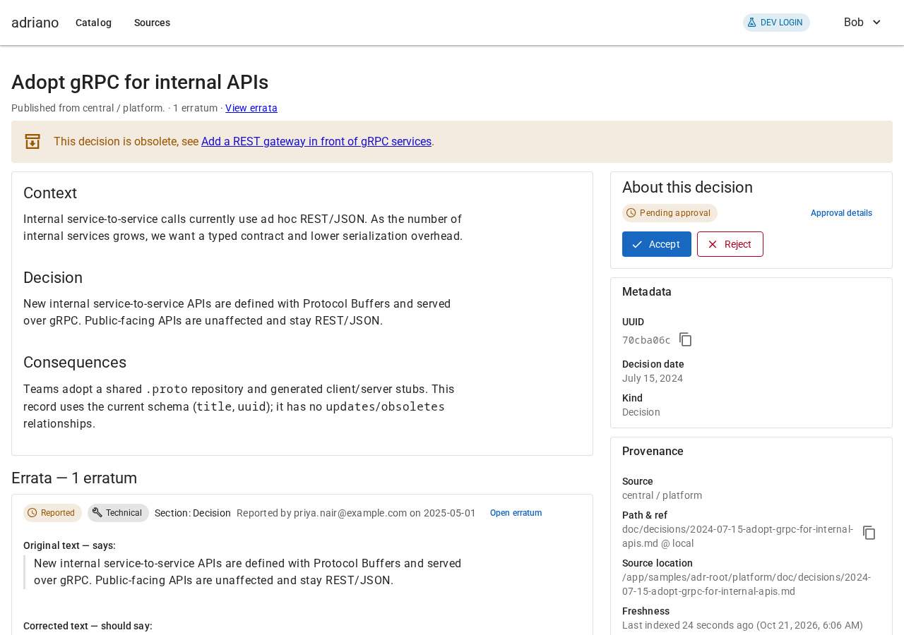

Scrolling to the errata section (`#errata`, linked from the header)
shows the erratum entry with its labelled, never-colour-only blocks:

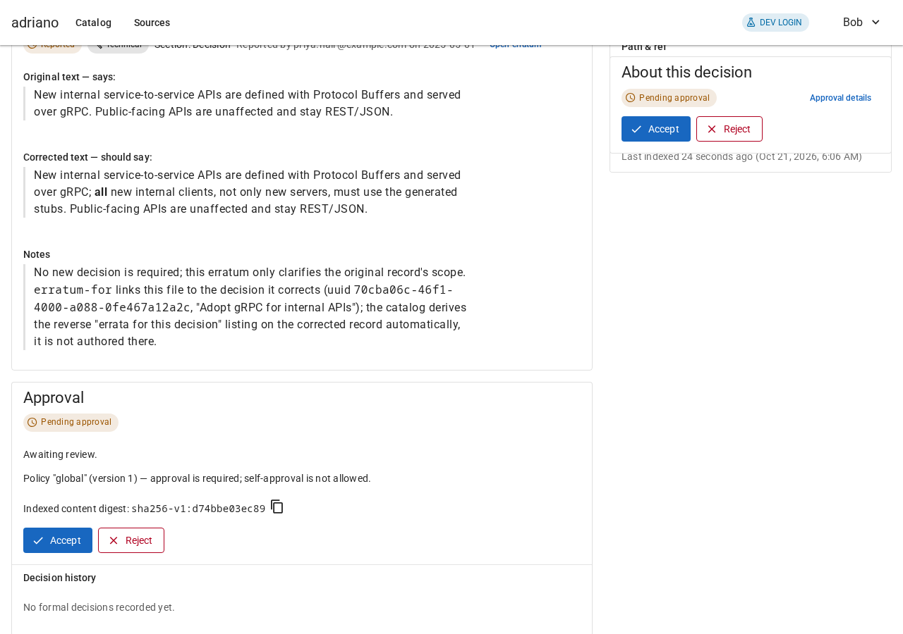

Opening the erratum itself ("Open erratum") shows its own small page:
an "Erratum for <decision>" banner, the erratum body, and an "About
this erratum" sidebar:

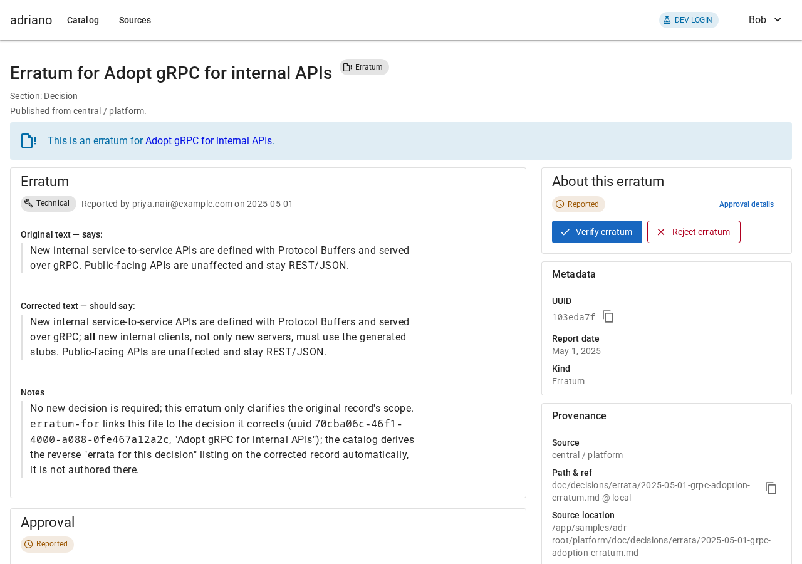

The same shape also covers **editorial** errata: "Use Stripe for card
payment processing" carries a wording-only correction reported against
its "Decision" section:

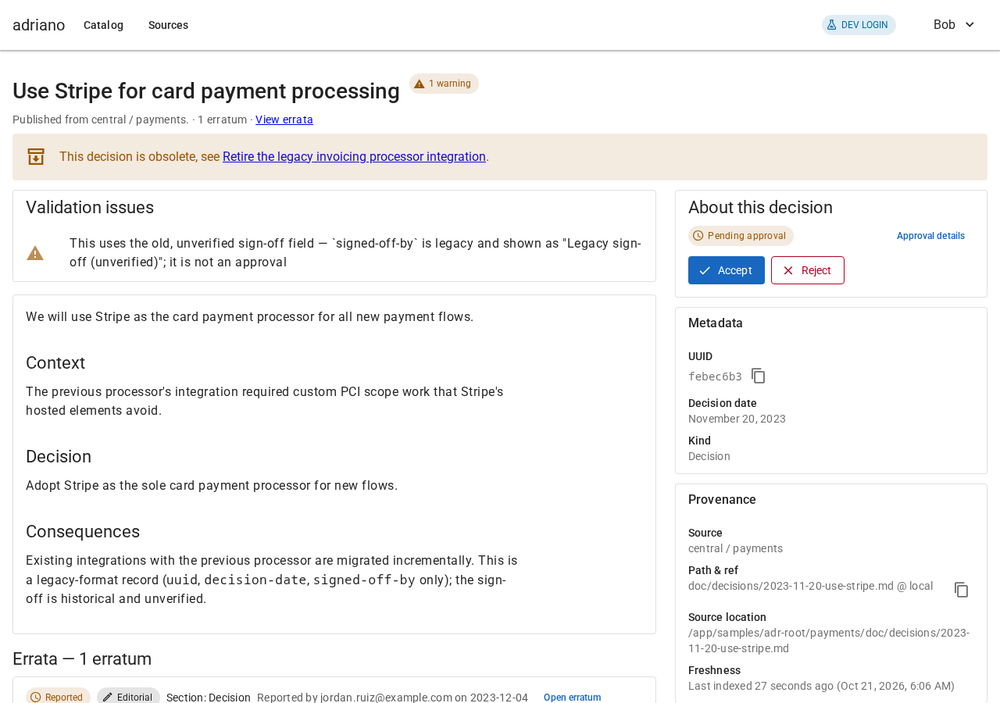

An erratum candidate can be pushed from a branch exactly like a
decision candidate, through the same push intake:

```text
$ export ADRIANO_PUSH_TOKEN_CENTRAL=<redacted>
$ export ADRIANO_API_BASE_URL=http://localhost:8180

$ samples/push-candidate.sh \
    samples/candidates/2026-02-01-erratum-ledger-snapshot-cadence.md \
    payments feature/erratum-ledger-snapshot-cadence central "" \
    doc/decisions/errata/2026-02-01-erratum-ledger-snapshot-cadence.md
PUT http://localhost:8180/api/v1/candidates (source=central project=payments ref=feature/erratum-ledger-snapshot-cadence uuid=201eeb83-8117-43c2-b429-aba67ee26f90)
{"record_id":"6d02fe50-...","digest":"sha256-v1:c7b6a9da5ca1...","created":true,"updated":false,"deduplicated":false,"issues":[],"catalog_path":"/records/6d02fe50-..."}
```

Before any decision is recorded, the target decision ("Adopt event
sourcing for the ledger service") shows the proposed erratum as its
own "· 1 proposed erratum · View errata" link in the header, and its
own group in the errata section, clearly separated from published
errata:

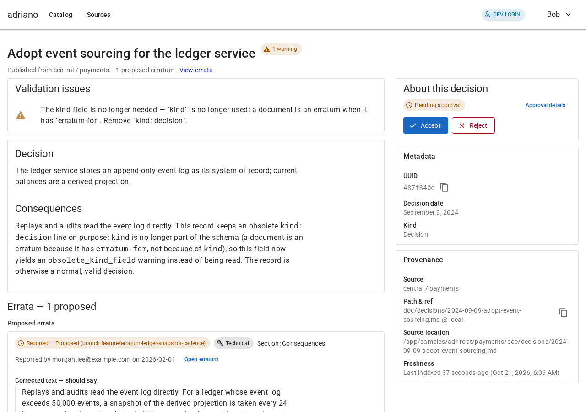

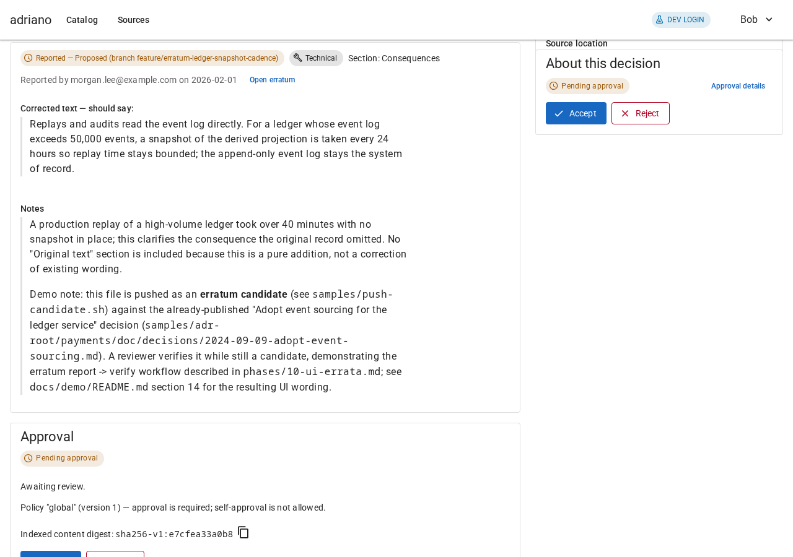

Signed in as a reviewer (role `adr-reviewer`), opening the erratum
candidate's own page offers "Verify erratum" / "Reject erratum"
(the same accept/reject dialog, RFC wording). Verifying asks for the
same exact-digest confirmation as a decision, and the dialog again
names the record in its own heading:

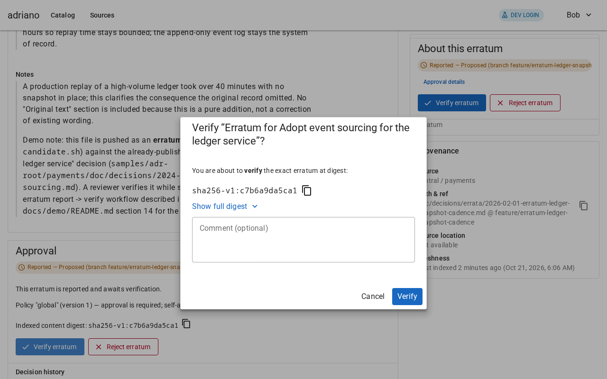

After confirming, the erratum's own status chip (both on its approval
card and in the "About this erratum" sidebar) reads "Verified —
Proposed (branch feature/erratum-ledger-snapshot-cadence)" — verified
for this exact content, but still only a candidate on a feature
branch — with the explanation sentence "This erratum was verified for
this exact content." beneath it, and a confirmation snackbar:

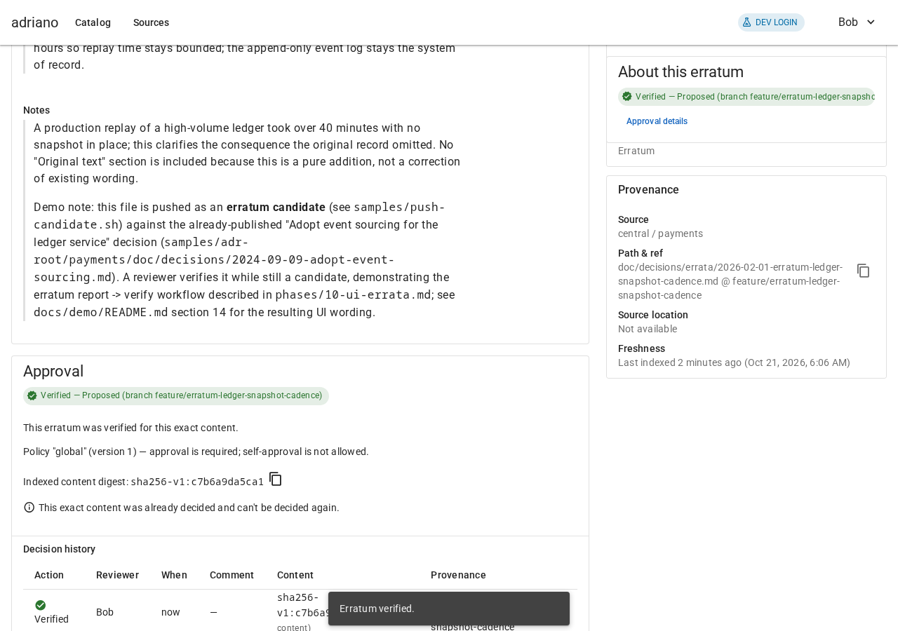

Because the erratum candidate is still proposed (kind `candidate`, not
yet merged/polled onto the published ref), the *target* decision
("Adopt event sourcing for the ledger service") keeps listing it under
"Proposed errata" rather than moving it into the published errata
group, with the same "Verified — Proposed (branch
feature/erratum-ledger-snapshot-cadence)" wording on its entry — the
target decision's own approval state (still "Pending approval") is
untouched by verifying the erratum:

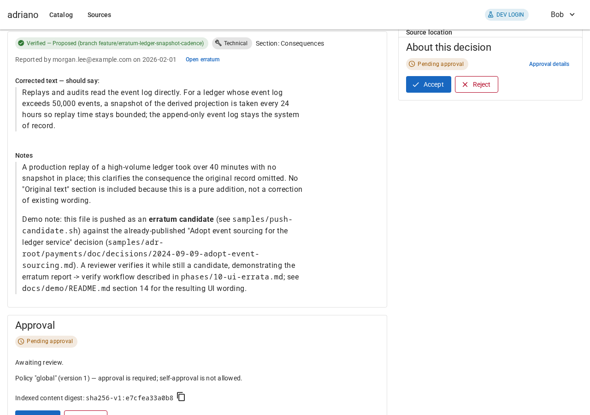

Search's "Show" select (Decisions / Errata / Both, synced to the URL
as `record_type`) sits next to the Published/Candidate toggle.
Selecting "Errata" lists every erratum, published or candidate, each
with its own "Erratum" and status chips and an "Erratum for
<decision>" subtitle:

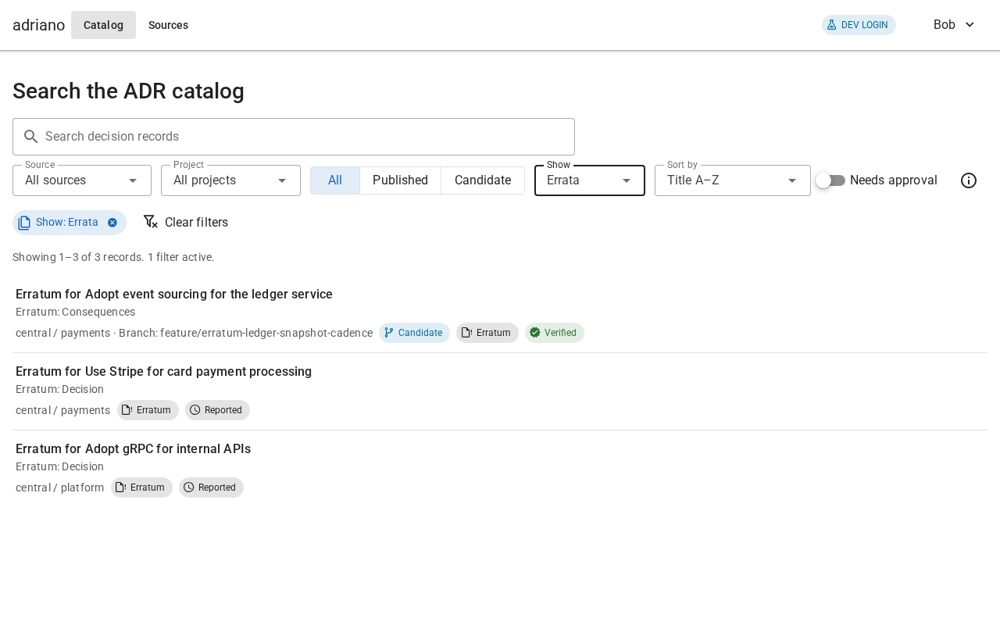

At a 390px mobile viewport the same gRPC decision page keeps the
sidebar below the main column (not beside it) with no horizontal
scrolling — a full-page capture, so the stacked sidebar is visible
below the document body:

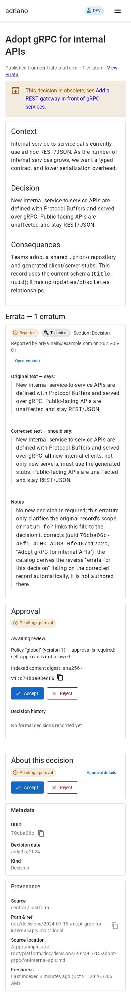

## Known limitations observed during this walk-through

- The "Needs approval" filter in step 9 returns effectively the whole
  catalog in this demo, because almost none of the original 14 sample
  decision records have been explicitly decided (only the three
  pushed-and-decided candidates, and the one record edited after
  promotion, have been). This is correct behaviour, not a bug: it
  simply reflects that a freshly indexed catalog starts with nothing
  accepted.

## Cleanup

```sh
# Stop the Vite dev server (Ctrl-C in its terminal), then:
task demo:down   # docker compose down -v: stops and discards the stack
```

`task demo:down` removes the containers and the stack's database
volume; it never touches the separate ephemeral dev/test database
(`adriano-db`, `task db:up`/`task db:down`). `.env.demo` and the push
token it contains are gitignored and generated once, the first time
`task demo` runs (its `demo:env` step is a no-op if the file already
exists, so the secret and push token stay stable across repeated
`task demo`/`task demo:down` cycles); delete `.env.demo` yourself to
force a fresh secret on the next run. No token or secret value
appears anywhere in this page.

Steps 7, 8 and 12 add, edit, and temporarily rename files under the
tracked `samples/adr-root/` tree (step 12 renames it back itself;
steps 7-8 leave a new/modified file behind). Discard those local
changes when you are done:

```sh
git checkout -- samples/ && git clean -fd samples/
```
