# Phase 1 demo walk-through

Audience: product owner and new users. This page walks through the
containerised demo stack screen by screen, so you can see what adriano
does without reading any code. Every step names the Phase 1 acceptance
criteria (see `phases/SPEC.md` "Phase 1 acceptance criteria") that it
demonstrates, in the form `(AC n)`.

## Reproduce it yourself

```sh
task demo       # build + start the stack, poll, print sign-in help
task demo:ui    # in a second terminal: dev-login UI on :5180
task demo:down  # stop and discard the stack when you are done
```

`task demo` builds the containers, starts PostgreSQL, the backend, and
the frontend (a production build with no dev-login UI, published on
<http://localhost:8180>), generates a gitignored `.env.demo` with a
random dev-auth secret and CI push token, and runs the first poll of
`samples/adr-root/`. `task demo:ui` runs a second, interactive
frontend (a Vite dev server with dev sign-in enabled) on
<http://localhost:5180>, proxying to the same backend, which is what
every screenshot below was taken from. Candidates are pushed with
`samples/push-candidate.sh` (see step 5).

Three identities are used throughout, matching this catalog's demo
`rbac`/`approval_policy` roles (`catalog.demo.yaml`):

| Role preset | Roles granted | Can read | Can decide | Can poll |
|---|---|---|---|---|
| Reader | `reader` | yes | no | no |
| Reviewer | `adr-reviewer` | yes | yes (listed in the policy) | no |
| Operator/Admin | `admin` | yes | no (not a reviewer) | yes |

## 1. Search the catalog (AC 1, 2, 4, 5)

A clean `task demo` start indexes 15 sample records on the first poll.
The landing page's search field is the primary control, with
source/project filters, a published/candidate toggle, and a "Needs
approval" switch — every filter lives in the URL, so a search is
shareable and restorable with back/forward. Browsing here never calls
a source (GitLab or the filesystem root); it only reads what the last
poll or push already indexed.

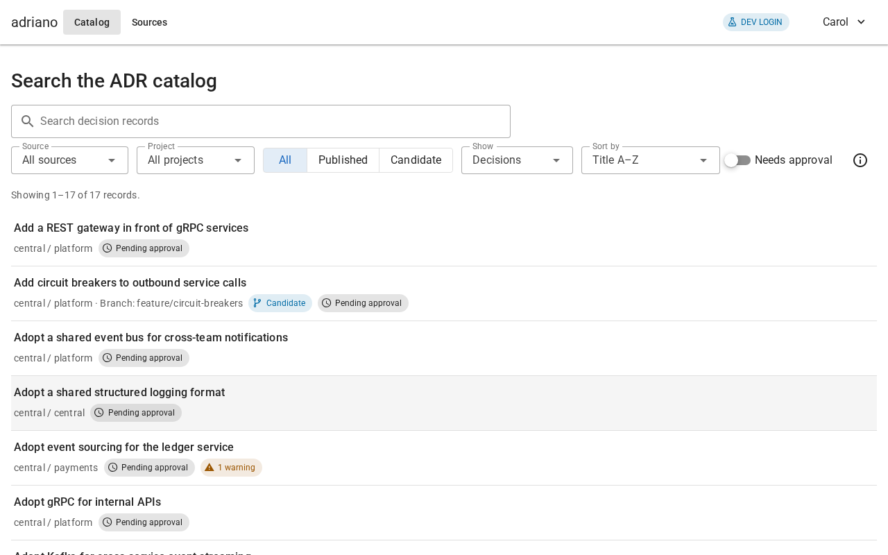

## 2. Filter by project and state (AC 2, 4)

Selecting `central` / `platform` and the "Published" toggle narrows
the same 18-record catalog to 9 platform records; the result count
and chips ("Published", "Pending approval", issue indicators) update
without a page reload.

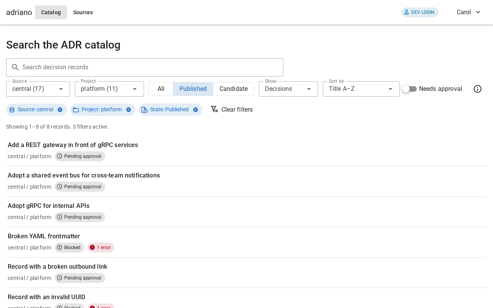

## 3. A legacy record (AC 14, 15, 24)

Opening "Retire the legacy invoicing processor integration" shows a
file written before the current schema existed: it uses the legacy
`deprecates` field (reported as a `legacy_alias` warning, with
"use `obsoletes` instead") and a legacy `signed-off-by` list, shown
under "Legacy sign-off (unverified)" with an explicit note that it is
historical, unauthenticated text and does not satisfy the approval
policy. The `deprecates` link itself still resolves and is navigable,
to "Use Stripe for card payment processing".

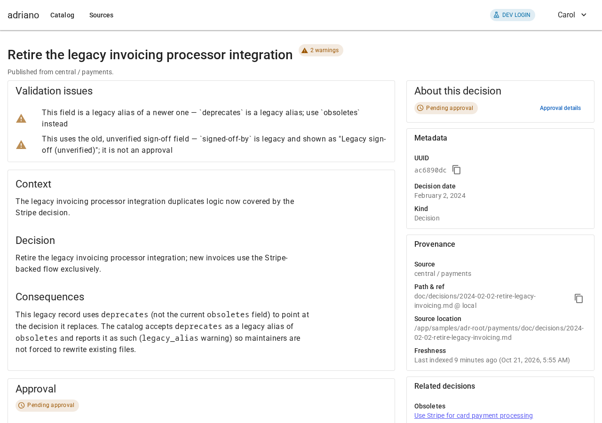

## 4. An isolated invalid record (AC 3, 23)

"Broken YAML frontmatter" has an unterminated quoted string in its
`title` line. The catalog stores it anyway, keyed by its file
location (no UUID can be read), and reports one `bad_yaml` error with
the exact parser message and line number. Every other record stayed
fully browsable the whole time — step 1's search results list is the
same 18 records, with only this one flagged.

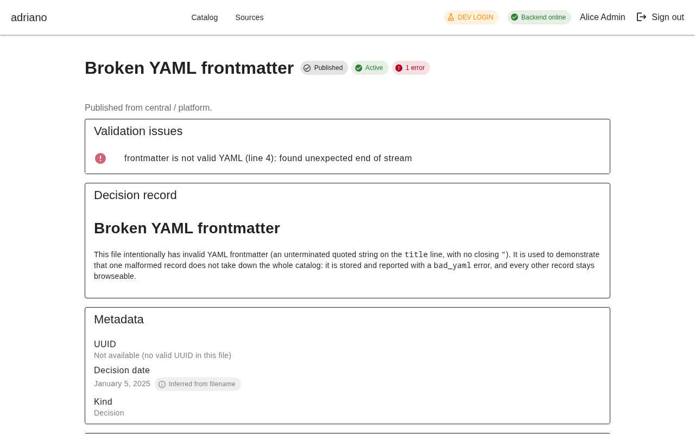

## 5. A candidate arrives via CI push (AC 7, 8, 12)

A CI job (or a developer, locally) pushes a candidate on a feature
branch with the same parse/validate/hash/persist pipeline polling
uses. Push never touches a published record: a candidate for an
existing ADR UUID is stored as its own row, never overwriting the
published one.

```text
$ export ADRIANO_PUSH_TOKEN_CENTRAL=$(grep ADRIANO_PUSH_TOKEN_CENTRAL .env.demo | cut -d= -f2)
$ export ADRIANO_API_BASE_URL=http://localhost:8180

$ samples/push-candidate.sh \
    samples/candidates/2026-01-05-use-redis-for-caching.md \
    platform feature/redis-cache
PUT http://localhost:8180/api/v1/candidates (source=central project=platform ref=feature/redis-cache uuid=b87a5fc5-a48f-49cb-a029-ac1f7c56c717)
{"record_id":"86914f84-...","digest":"sha256-v1:a0b7e2410924...","created":true,"updated":false,"deduplicated":false,"issues":[],"catalog_path":"/records/86914f84-..."}

$ samples/push-candidate.sh \
    samples/candidates/2026-01-10-adopt-kafka-for-events.md \
    platform feature/kafka-events
PUT http://localhost:8180/api/v1/candidates (source=central project=platform ref=feature/kafka-events uuid=6b1b7968-e918-497b-ab90-5287af582744)
{"record_id":"b30a0f36-...","digest":"sha256-v1:45d5d718b2f0...","created":true,"updated":false,"deduplicated":false,"issues":[],"catalog_path":"/records/b30a0f36-..."}

$ samples/push-candidate.sh \
    samples/candidates/2026-01-15-add-circuit-breakers.md \
    platform feature/circuit-breakers
PUT http://localhost:8180/api/v1/candidates (source=central project=platform ref=feature/circuit-breakers uuid=3f5e1b69-f3bf-4fb4-b173-ccfa92d8baab)
{"record_id":"d822d454-...","digest":"sha256-v1:beb3d49268...","created":true,"updated":false,"deduplicated":false,"issues":[],"catalog_path":"/records/d822d454-..."}
```

Searching for "Redis" now shows the pushed file as a distinct
candidate row, with its branch as a chip and "Needs approval":

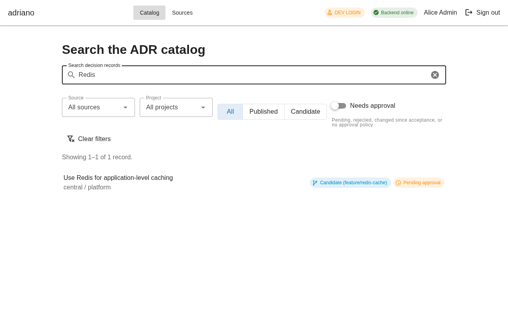

## 6. A reviewer accepts the candidate (AC 16, 22, 26)

Signed in as Bob (role `adr-reviewer`, listed in the configured
`global` policy), opening the Redis candidate offers Accept/Reject.
Accepting asks for explicit confirmation of the **exact digest** being
decided, so a reviewer is never approving "whatever is there now":

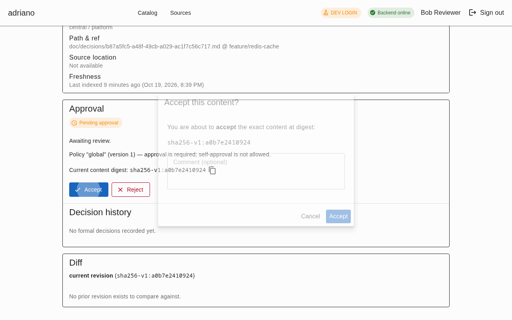

After confirming, the record shows "Accepted — candidate": the
decision is recorded for this content hash before the change is ever
published, so implementation can start from the accepted candidate.

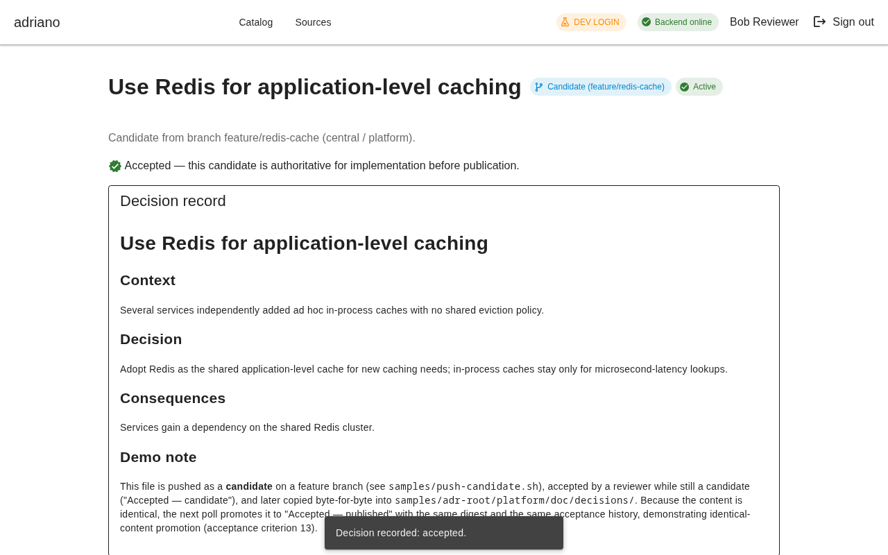

## 7. Identical-content promotion (AC 13, 17)

Copying the exact same file into the filesystem source's published
tree and polling again promotes the accepted candidate automatically:
the published row is accepted too, with the **same digest** and the
**same decision history** — nothing is re-reviewed or re-copied,
because acceptance is keyed by (identity, content digest), not by
which ref the content happened to live on.

```text
$ cp samples/candidates/2026-01-05-use-redis-for-caching.md \
    samples/adr-root/platform/doc/decisions/
$ task demo:poll
docker compose exec backend adriano poll
INFO app.services.polling: poll central finished: ok PollCounts(projects=3, documents=16, unchanged=15, fetched=1, created=1, updated=0, same_content=0, tokens_refreshed=0, deleted=0, skipped_owned=0, failed=0)
central: ok (projects 3, documents 16, fetched 1, unchanged 15, created 1, updated 0, deleted 0, failed 0)
```

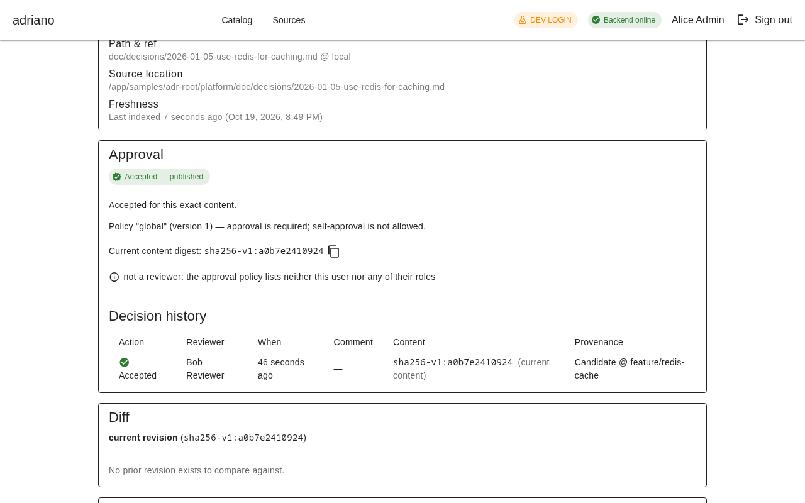

## 8. Editing breaks acceptance; the diff shows why (AC 18, 20)

Editing the published file's content (even a single sentence) and
polling again changes its digest. The old acceptance stays in history,
but it no longer covers the new current content, so the record flips
to "Changed since acceptance" and needs a fresh decision. The diff
panel reproduces a unified diff from the last accepted snapshot to the
current one without needing any Git history — the catalog keeps its
own content-addressed revisions for exactly this.

```text
$ # edit samples/adr-root/platform/doc/decisions/2026-01-05-use-redis-for-caching.md
$ task demo:poll
docker compose exec backend adriano poll
INFO app.services.polling: poll central finished: ok PollCounts(projects=3, documents=16, unchanged=15, fetched=1, created=0, updated=1, same_content=0, tokens_refreshed=0, deleted=0, skipped_owned=0, failed=0)
central: ok (projects 3, documents 16, fetched 1, unchanged 15, created 0, updated 1, deleted 0, failed 0)
```

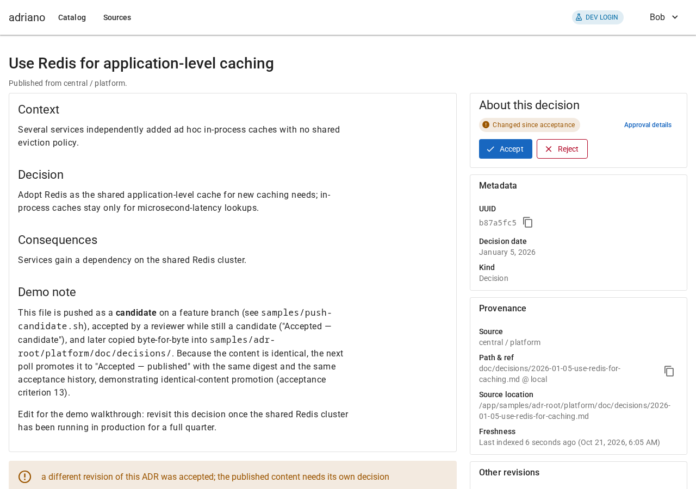

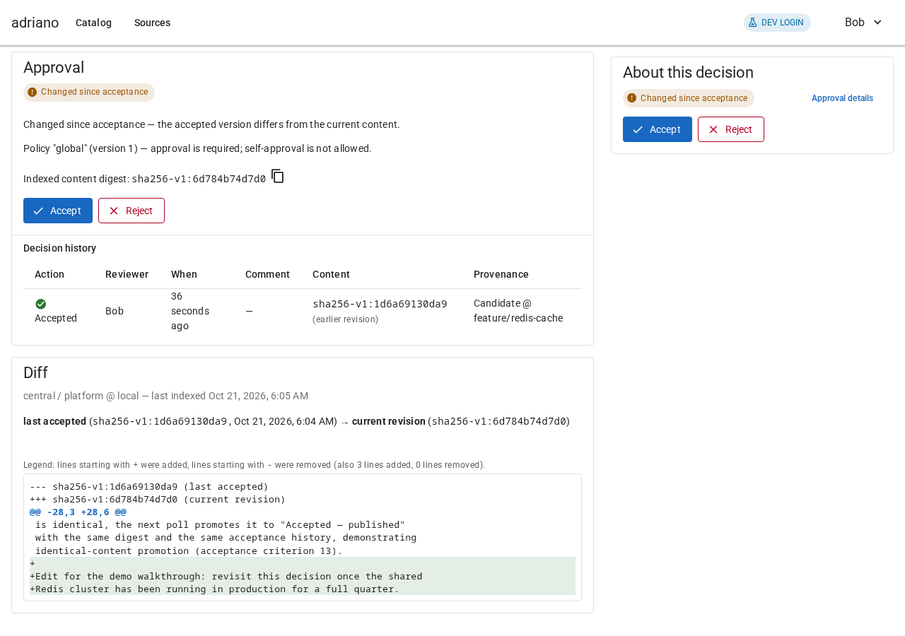

## 9. The "Needs approval" filter (AC 19)

Turning on "Needs approval" returns every record whose current content
is not accepted: still-pending records, rejected candidates, and the
Redis record that changed since its last acceptance — one switch
covers all of the policy's "not settled" states at once.

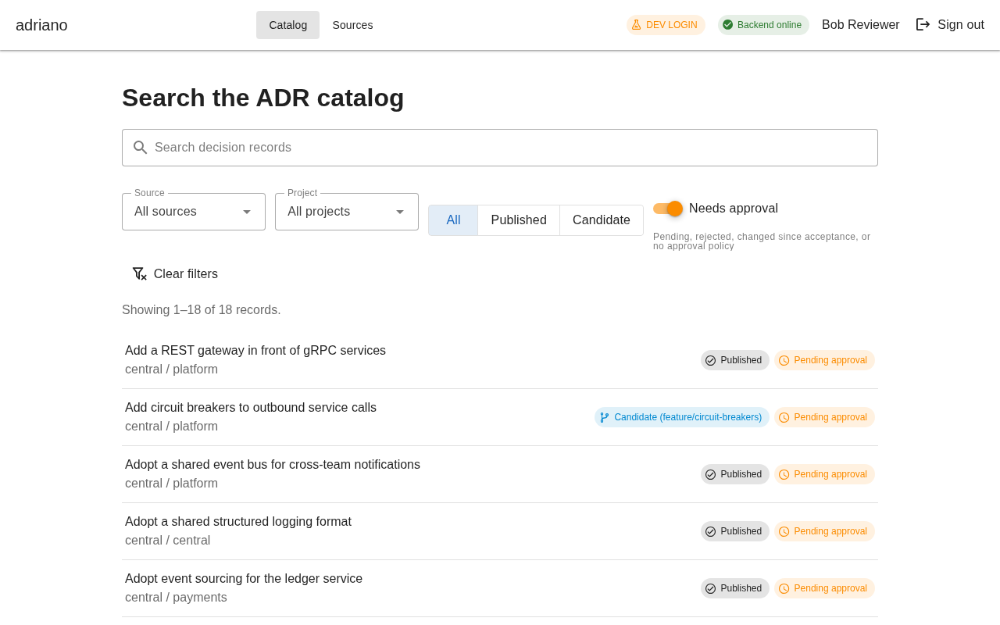

## 10. Rejecting a candidate (AC 3, 16, 22)

The Kafka candidate proposes a second, competing implementation for an
already-proposed shared event bus. Bob rejects it with a comment,
after an explicit confirmation checkbox (rejection is the more
consequential action, so it asks for one extra deliberate step):

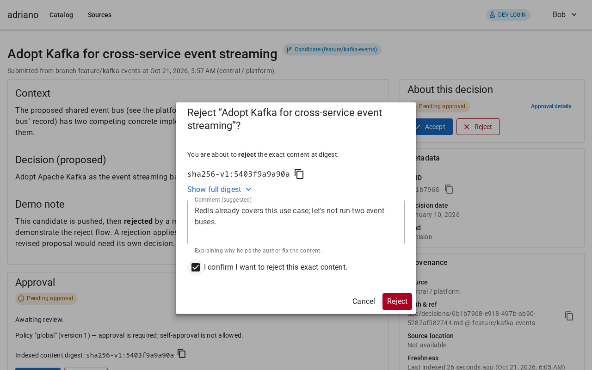

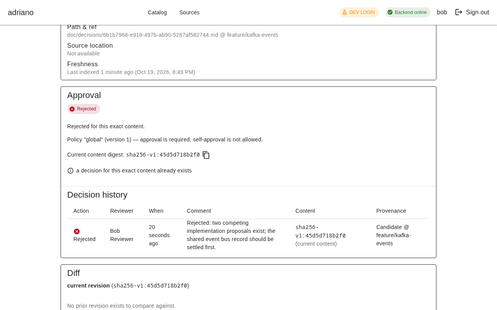

A rejection is scoped to this exact content hash only: a revised Kafka
proposal pushed later would need its own decision.

## 11. What a read-only reader sees (AC 2, 3, 26)

Signed in as Carol (role `reader`, read permission only, not listed in
the approval policy), the still-pending "Add circuit breakers"
candidate shows no Accept/Reject controls at all, and states the exact
reason instead of a disabled, unexplained button: "not a reviewer: the
approval policy lists neither this user nor any of their roles."

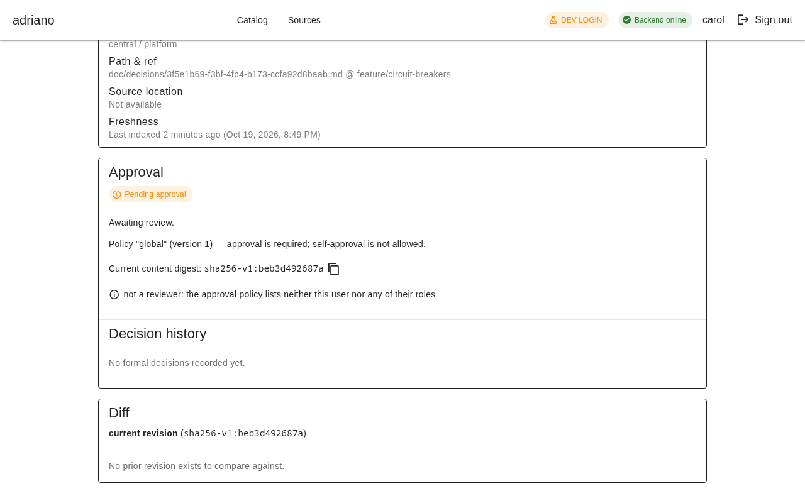

## 12. Operators, polling, and a source failure (AC 3, 6, 7, 9, 10, 11, 21)

The Sources page lists every registration's type, intake modes,
published ref, and freshness. Operators (role `admin`, granted
`operate`) get "Poll all" and a per-row "Poll now"; everyone else sees
a note naming who can poll instead of a disabled control.

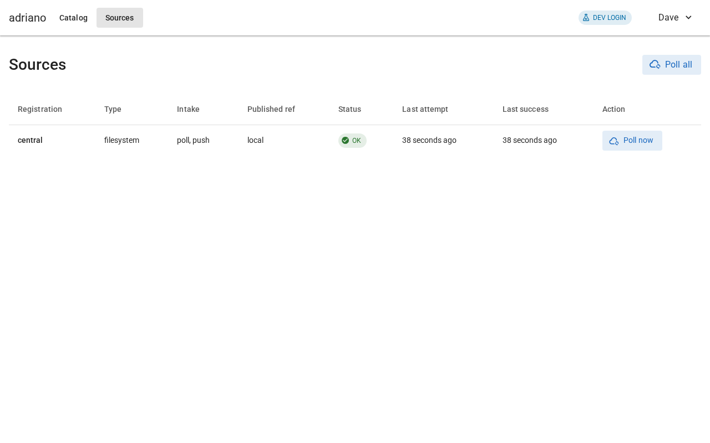

To demonstrate a source failure without touching real infrastructure,
the sample root is renamed so the filesystem adapter cannot read it,
then polled:

```text
$ mv samples/adr-root samples/adr-root.bak
```

Polling now fails cleanly: the registration is marked `Failed` with
the exact problem and a recovery hint, while every previously indexed
record stays fully browsable (nothing is deleted on a failed poll):

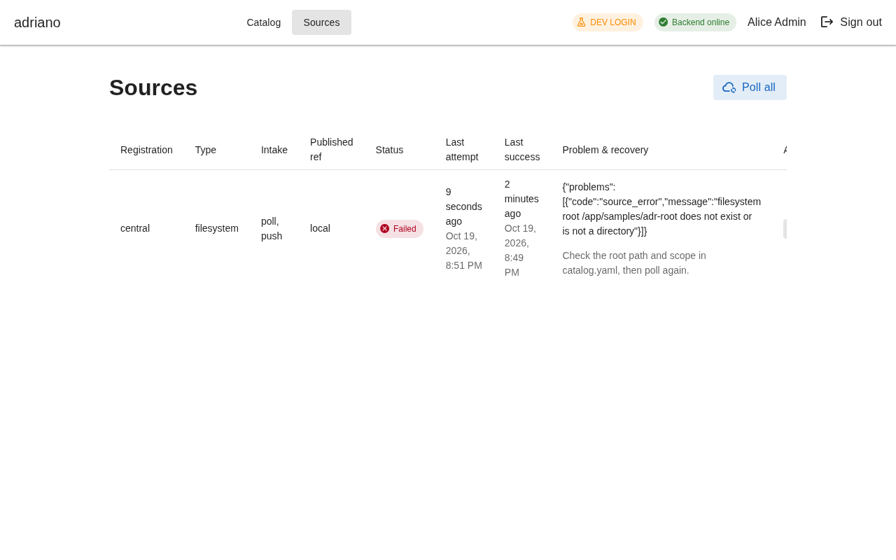

Any record from that source now also shows a stale banner, honestly
stating that the current page may not reflect the live published
revision — it never silently claims the stale content is current:

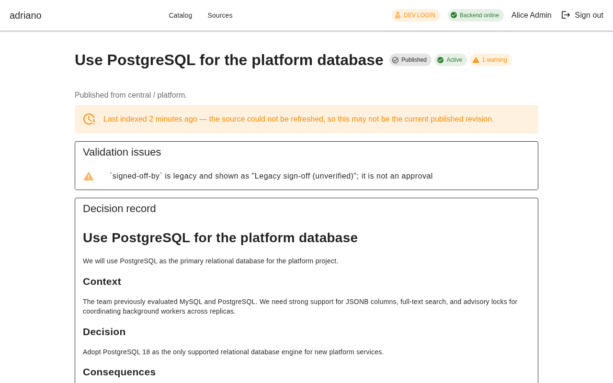

Restoring the directory and polling again recovers automatically,
with no manual repair step:

```text
$ mv samples/adr-root.bak samples/adr-root
$ # Poll now (UI) or: task demo:poll
```

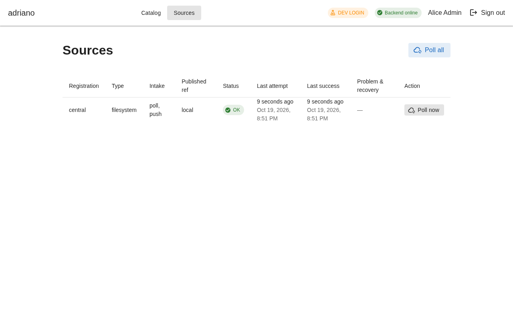

## 13. Small screens (AC 4)

The same search page at a 390px mobile viewport: filters stack, result
chips wrap, and every control stays reachable and legible without
horizontal scrolling. Below the `md` breakpoint the app bar itself
collapses too: only the "adriano" product name and the "DEV LOGIN"
mode indicator (shortened to "DEV", with its full meaning in an
`aria-label`/`title`) stay inline; navigation, backend status, the
configuration-issue warning, and the signed-in user's name/"Sign out"
move behind a single "Open menu" button, reachable by keyboard and
closing on Escape with focus returned to that button.

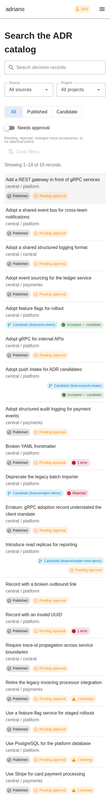

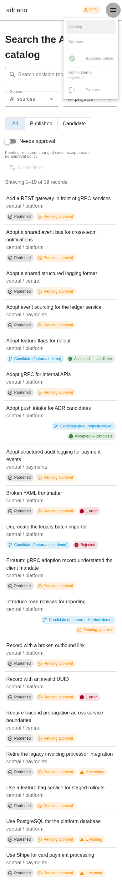

## Known limitations observed during this walk-through

- The "Needs approval" filter in step 9 returns effectively the whole
  catalog in this demo, because none of the original 15 sample
  records have been explicitly decided (only the three pushed
  candidates have). This is correct behaviour, not a bug: it simply
  reflects that a freshly indexed catalog starts with nothing
  accepted.

## Cleanup

```sh
# Stop the Vite dev server (Ctrl-C in its terminal), then:
task demo:down   # docker compose down -v: stops and discards the stack
```

`task demo:down` removes the containers and the stack's database
volume; it never touches the separate ephemeral dev/test database
(`adriano-db`, `task db:up`/`task db:down`). `.env.demo` and the push
token it contains are gitignored and regenerated fresh on every
`task demo`; no token or secret value appears anywhere in this page.
