# UI/UX review — desktop layout (2026-10-20)

An expert review of the adriano frontend after phase 10. It covers
alignment, accessibility (WCAG 2.2 AA), Shneiderman's eight golden rules,
Nielsen's ten heuristics, Fitts's law (with Hick's and Jakob's laws), and an
audit of elements that are too prominent or distracting.

This is research only. The resulting change plan is
`phases/11-ui-ux-updates.md`. Every finding below has an ID that the plan's
tasks refer to.

Each finding's "Fix" describes the intended result, not how to build it.
The plan's "Vuetify first" section decides the mechanism: theme and
defaults come before any custom CSS.

## Method

- **Build:** Vite dev server (5173) and FastAPI dev server (8100) against
  the local test database (17 records, 2 sources, 1 decision event).
  Database row counts were the same before and after the review; no
  decision was submitted.
- **Roles:** dev sign-in as reader (`adr-reader`), reviewer
  (`adr-reader, adr-reviewer`) and operator (`admin`), matching the local
  `catalog.yaml`.
- **Viewports:** 1366×768, 1920×1080 and 2560×1440.
- **Passes:**
  - Screenshots of every route and record state.
  - Box measurement of the left edges of the app-bar title, container,
    headings and fields (`getBoundingClientRect`).
  - Interactive targets smaller than 24 px, and buttons shorter than 36 px.
  - Text contrast from computed colours, composited over the actual
    background.
  - A keyboard-only Tab walk and the open/close focus behaviour of dialogs.
  - The dark theme, forced at runtime because the app has no way to reach
    it (see G-06).
  - 200% zoom, emulated as 683×384 at device pixel ratio 2.
- **Tooling:** Playwright with bundled headless Chromium, driven from
  scripts in the session scratchpad. The Playwright MCP browser has no
  Chrome installed. No axe scan was run (agreed scope).
- **Severity:** Nielsen's 0–4 scale (4 = catastrophe, 3 = major, 2 = minor,
  1 = cosmetic). **Effort:** S (under half a day), M (about a day), L (more).

Principle abbreviations used below:

- **N1–N10:** Nielsen's heuristics. N1 is visibility of system status, N2
  match with the real world, N4 consistency, N6 recognition over recall, N8
  aesthetic and minimalist design, N9 error recovery.
- **S1–S8:** Shneiderman's golden rules. S1 is consistency, S3 informative
  feedback, S8 reducing short-term memory load.
- **SC x.y.z:** a WCAG 2.2 success criterion.

## Summary — top issues

1. **G-01 (3):** Warning- and info-coloured text fails contrast
   (2.1–3.9:1). This covers every "Pending approval", "Reported" and
   "1 warning" chip and the errata banners.
2. **R-01 (3):** A reviewer's main task, Accept/Reject, sits about 1,600 px
   down the record page, below the body and the errata. The sidebar only
   has a link to it.
3. **S-01 (3):** Search results put the status chips 1,100–1,300 px away from
   the title they describe, with a ragged left edge.
4. **S-02 (3):** "Published" and "Pending approval" appear on all 14 rows.
   Status colour no longer carries any information.
5. **R-02 (3):** Records that cannot be approved (no valid UUID) still say
   "Pending approval" in three places.
6. **G-02 / G-03 (2):** The app bar ignores the content grid. The content's
   left edge jumps 60 px at 1920 wide and 360 px at 2560 wide when moving
   from search to a record.
7. **R-04 (2):** Status banners repeat information shown elsewhere on the
   page, and an obsolete record is shown in error red.
8. **S-04 (2):** The "Needs approval" filter mode has no active-filter
   summary, and the result count line doesn't mention it.
9. **D-01 / D-02 (2):** Decision dialogs have no accessible name, and they
   don't name the record being decided.
10. **G-06 (2):** A dark theme is defined but cannot be reached.

## Global and app shell

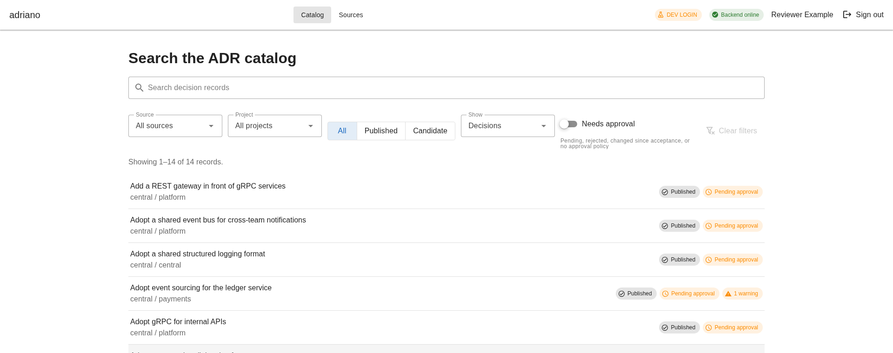

**G-01 — Status colours fail text contrast** (severity 3, effort M)
- **Principle:** SC 1.4.3.
- **Evidence:**
  - Light-theme `warning` (#FB8C00) on its 12% tonal tint is about 2.1:1. It
    is used for "Pending approval", "Reported", "1 warning",
    "Disabled (stale)" and the "DEV LOGIN" chip.
  - The `info` alert text is 3.9:1, and `success` chip text is 4.4:1 at
    12 px. All of these need 4.5:1.
  - The dark theme passes everywhere.
- **Source:** `plugins/vuetify.ts:22-24`, `components/StatusChip.vue:24-33`,
  and the `v-alert`s in `components/record/RecordStatusBanners.vue`.
- **Fix:**
  - Add contrast-safe light-theme tokens for status text (for example
    darker `warning`, `info` and `success` variants), or render chip text in
    on-surface colour and let the icon and tint carry the hue.
  - Check every token pair for at least 4.5:1.

**G-02 — App bar not aligned with the content grid** (severity 2, effort S)
- **Principle:** S1, Jakob's law, alignment.
- **Evidence:**
  - The title sits at x=20 while content starts at x=199 (1366), 276 (1920)
    and 296 (2560).
  - The right-hand cluster ends at 1900 while content ends at 1644.
  - Catalog/Sources are centred in the leftover space, so their position
    changes with the width of the user's display name (it moves by about
    10 px between reader and operator).
- **Source:** `App.vue:137-223`.
- **Fix:** Wrap the app-bar content in the same max-width container as
  `v-main`, and put the nav straight after the brand, left-aligned.

**G-03 — Content width and left edge jump between routes** (severity 2,
effort S)
- **Principle:** S1, N4.
- **Evidence:**
  - Search uses the default container, 1400 px at 1920 and 2000 px at 2560.
  - The record route's "wide" container is 1280 px, which is *narrower* on
    large screens.
  - Going from search to a record moves the left edge 60 px (1920) or
    360 px (2560).
- **Source:** `App.vue:226-230,299-301`, `router/index.ts` (`meta.wide`).
- **Fix:** Use one page max-width (about 1280–1440 px) for every route, and
  drop `meta.wide`.

**G-04 — App-bar chrome too loud** (severity 2, effort S)
- **Principle:** N8, prominence.
- **Evidence:** A green "Backend online" chip is always visible, including
  before sign-in, and the amber "DEV LOGIN" chip fails contrast. Neither
  calls for any action in the normal state.
- **Source:** `App.vue:158-191`.
- **Fix:**
  - Hide the health chip while healthy. Show it only when degraded or
    offline, inside a `role=status` region.
  - Keep the dev-login indicator, since it is a persistent mode under the
    `ui-modes` rules, but restyle it with a passing contrast pair and a
    neutral/outlined look.

**G-05 — Heading hierarchy flat and partly inverted** (severity 2, effort M)
- **Principle:** SC 1.3.1, S8.
- **Evidence:**
  - h1 is `text-h5` and h2 is `subtitle-1`, so the levels look much the
    same.
  - The sidebar h2 "About this decision" is bold, while the card titles
    under it ("Metadata", "Provenance") are larger but are plain `div`s
    rather than headings.
  - Markdown h2s inside the body ("Context") outweigh the card title above
    them.
- **Source:**
  - `record/RecordSidebar.vue:64`, `RecordMetadataCard.vue:31`,
    `RecordProvenanceCard.vue:26`, `RecordLinksCard.vue:29,57`,
    `RecordSiblingsCard.vue:19`, `ApprovalCard.vue:162`,
    `RecordIssuesList.vue:17`
  - `EmptyState.vue` (its title is a `
`)
- **Fix:**
  - Define a type scale for the page title, section, sidebar section and
    body.
  - Make every card title a real heading (`tag="h2"` or `"h3"`).

**G-06 — Dark theme unreachable** (severity 2, effort S)
- **Principle:** user control (S7), accessibility preference.
- **Evidence:**
  - `defaultTheme: "light"`, with no `prefers-color-scheme` handling and no
    toggle. The OS dark setting changes nothing.
  - When forced, the dark theme passes contrast. It does show two-tone
    sidebar cards (title strip on `background`, list on `surface`) and
    harsh white 1 px card outlines.
- **Source:** `plugins/vuetify.ts:14`.

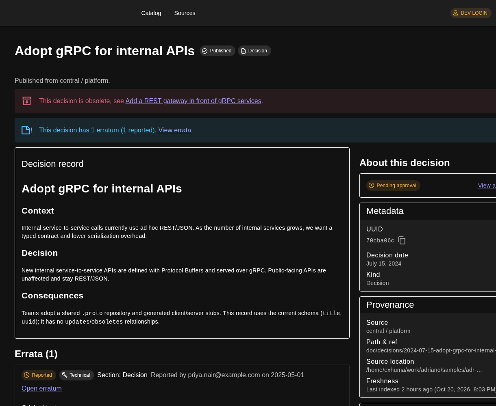

- **Fix:**
  - Follow the OS by default, and add a light/dark/system choice in a user
    menu. Remembering the choice in browser storage is fine, since it is a
    convenience.
  - Make each card use a single surface.

**G-07 — Heavy, inconsistent card outlines** (severity 2, effort S)
- **Principle:** N8, S1.
- **Evidence:**
  - Record cards have a black 1 px outline at full emphasis, while the
    errata card next to them uses a light outline.
  - Stacked boxes (alert, then card, then a card inside a card) make the
    page look like a form.
- **Source:** `variant="outlined"` cards in `components/record/*`,
  `ApprovalCard.vue`, `DiffPanel.vue`.
- **Fix:** Use one card style: a low-emphasis border or flat with dividers,
  and no nested borders.

**G-08 — Weak focus indicator on icon and small buttons** (severity 2,
effort S)
- **Principle:** SC 2.4.7.
- **Evidence:** Text buttons and toggles show a visible ring. The x-small
  copy buttons only get a faint grey circle (about 1.2:1 against white).

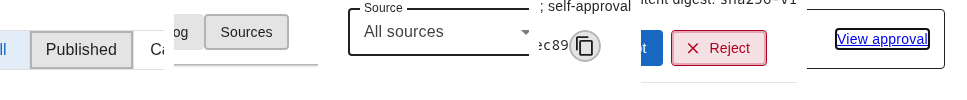

- **Source:** `ShortIdCopy.vue:45-52`, `ApprovalCard.vue:127-133`.
- **Fix:** Add a global `:focus-visible` outline of 2 px in `primary` with a
  2 px offset, and make the copy buttons `size="small"` (at least 32 px with
  padding).

**G-09 — Empty live regions in every field** (severity 1, effort S)
- **Principle:** SC 4.1.3.
- **Evidence:** Each `v-text-field` and `v-select` on search renders an empty
  `role="alert"` message slot. That is six empty alerts in the accessibility
  tree.
- **Source:** `SearchView.vue:217-285`, `DevLoginDialog.vue`.
- **Fix:** Add `hide-details` wherever there is no hint or validation; keep
  hints only where they matter.

**G-10 — Non-interactive list in the tab order** (severity 1, effort S)
- **Principle:** SC 2.4.3.
- **Evidence:** On the record page, the Provenance `v-list` (a `div` with
  `role=list`) takes a tab stop.
- **Source:** `record/RecordProvenanceCard.vue`.
- **Fix:** Render it as a static list (`tabindex="-1"`, or a plain
  `dl`/`ul`).

**G-11 — Duplicated `.sr-only` CSS** (severity 0, effort S)
- **Principle:** maintainability.
- **Evidence:** It is copied into 4 components.
- **Fix:** Move it into one shared utility class.

## Sign-in

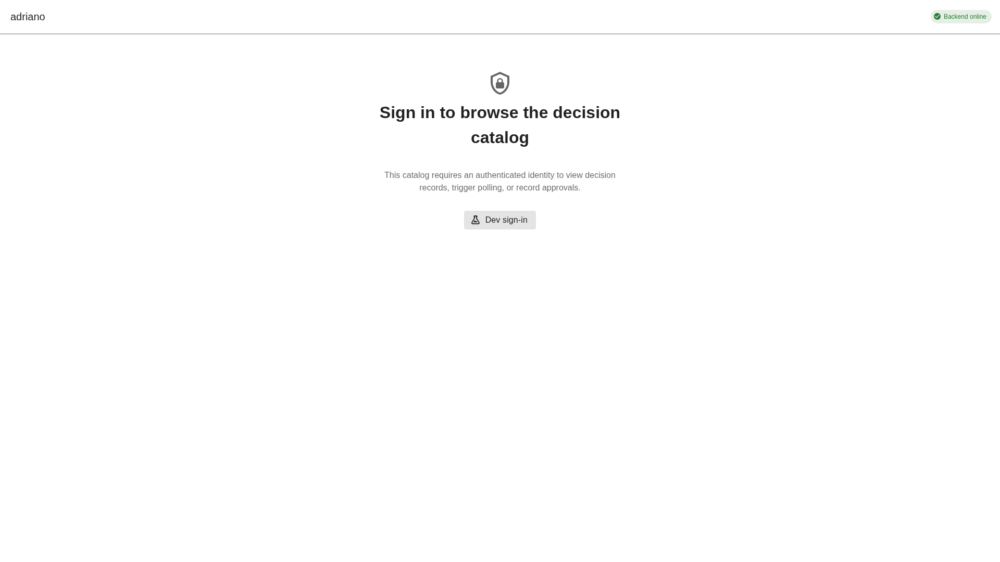

**A-01 — Weak primary action on the sign-in screen** (severity 1,
effort S)
- **Principle:** N8, Fitts's law.
- **Evidence:**
  - "Dev sign-in", the only action, is a grey flat button.
  - The heading wraps badly ("…the decision / catalog") because of the
    narrow measure.
  - The health chip appears before sign-in.
- **Source:** `SignInScreen.vue:26-48`.
- **Fix:** Make the button `color="primary"`, widen the heading measure (or
  shorten the copy), and hide the health chip while healthy (G-04).

## Search

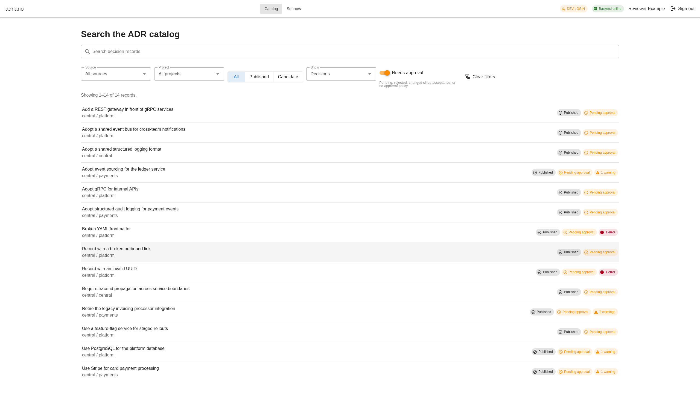

**S-01 — Status chips far from the titles they describe** (severity 3,
effort M)
- **Principle:** proximity (Gestalt), Fitts's law and eye travel, S8.
- **Evidence:**
  - Titles start at x=280. The chips are right-aligned and end at about
    1640 (1920) or 2260 (2560).
  - Because the number of chips varies by row, their left edge is ragged,
    so it can't be scanned as a column.
- **Source:** `SearchView.vue:352-382`.
- **Fix:** Put the status inline on the row's second line, after
  `source / project`, left-aligned. Alternatively, use fixed columns
  (Title · Source/Project · State · Approval · Issues).

**S-02 — Redundant chips saturate colour** (severity 3, effort S)
- **Principle:** N8, Hick's law, colour as signal.
- **Evidence:**
  - "Published" plus "Pending approval" appear on all 14 rows. Orange
    appears on every row, so a real "1 error" or "2 warnings" doesn't stand
    out.
  - The pending state is better shown through the Needs-approval filter and
    a count.
- **Fix:**
  - Hide the state chip when it has the default value (Published), and show
    only exceptions (Candidate, Changed since acceptance, Rejected).
  - Show pending approval as quiet neutral text or an icon.
  - Keep strong colour for issues (error/warning) and rejection only.

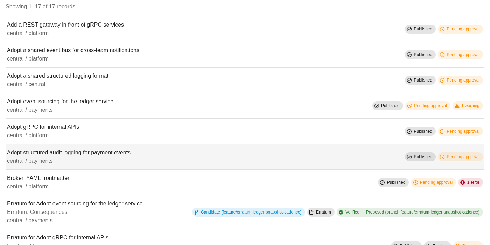

**S-03 — Filter row misaligned** (severity 2, effort S)
- **Principle:** alignment, S1.
- **Evidence:**
  - The selects are 48 px tall and the button toggle 40 px; the switch has
    a two-line 11 px hint underneath with tight leading.
  - Control tops and baselines differ.
  - "Clear filters" drifts: it sits flush right at 1920 but mid-row at
    2560.
- **Source:** `SearchView.vue:227-295,404-460`.
- **Fix:**
  - Use one density for the whole bar so every control shares a top line.
  - Move the switch hint into an info tooltip, or into the label as
    "Needs approval ⓘ".
  - Anchor "Clear filters" at the end of the bar.

**S-04 — Active-filter mode not summarised** (severity 2, effort M)
- **Principle:** N1, N6, the `ui-modes` rules.
- **Evidence:**
  - With "Needs approval" on, the only sign is an orange switch (warning
    colour on a deliberate filter).
  - The count line still reads "Showing 1–14 of 14 records." with no mention
    of the filter.
  - There is no chip summary with a per-filter clear.
- **Fix:**
  - Add a persistent row of active filters between the bar and the results,
    in a `role=status aria-live=polite` region. Each active filter gets a
    closable tonal chip ("Needs approval", "Source: central", "Show:
    errata").
  - Use a non-warning colour for the switch.
  - Mention the filters in the count line ("14 records need approval").
  - Keep the order of the filter modes in a plain TypeScript module, per the
    `module-vue-vuetify` mode-indicator rules.

**S-05 — Chips used as sentences** (severity 2, effort S)
- **Principle:** N8, N4.
- **Evidence:** "Verified — Proposed (branch feature/erratum-ledger-snapshot-
  cadence)" and "Candidate (feature/…)" repeat the branch twice on one row,
  and are 300+ px wide.
- **Source:** `SearchView.vue:366-382`, `utils/labels.ts`
  (`erratumStatusLabel`, `displayStatusLabel`).
- **Fix:** Keep chip text to 1–2 words. Show the branch once, as secondary
  text in the row's metadata line.

**S-06 — Search field too wide** (severity 1, effort S)
- **Principle:** Fitts's law and measure.
- **Evidence:** The search field is 1370 px wide at 1920 and 2000 px at
  2560. Typed text sits far from the filters.
- **Fix:** Cap it at about 720 px, or let it share a row with the filters.

**S-07 — "Clear filters" also clears the query** (severity 1, effort S)
- **Principle:** N2.
- **Evidence:** On the no-results state, the button resets the text query
  too, but its label says "filters". The empty-state title is a `
`.
- **Source:** `SearchView.vue:287-294,319-337`,
  `composables/useSearchQuery.ts:182-192`.
- **Fix:** Label it "Clear search and filters" when a query is set, and make
  the title a heading.

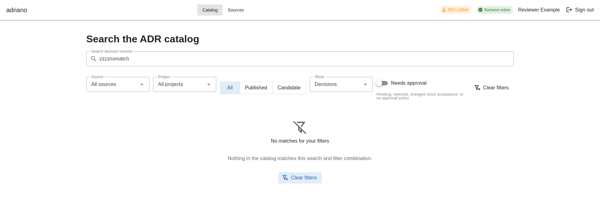

**S-08 — No visible sort order** (severity 1, effort M)
- **Principle:** N1.
- **Evidence:**
  - With a query, results are ranked by relevance, then title. Without a
    query they are sorted by title. Neither order is stated.
  - Reviewers cannot sort by recency.
- **Source:** `storage/postgres/search.py` (`_key_columns`, `_order`).
- **Decision (2026-10-20):** add Relevance, Title A–Z and Recently changed.

## Record page

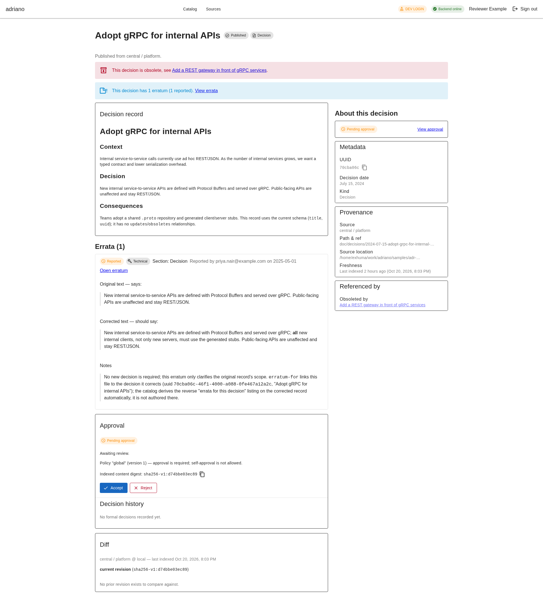

**R-01 — Approval actions out of reach** (severity 3, effort M)
- **Principle:** Fitts's law, N7, S8.
- **Evidence:**
  - Accept and Reject sit at y≈1620 at 1920 and y≈1600 at 1366. A reviewer
    has to scroll past the body and errata to reach them.
  - The sidebar shows a status chip and a "View approval" link.
  - The sidebar is not sticky, so the right column is empty while scrolling
    through the long main column (see 15).
- **Source:** `views/RecordView.vue:171-214`,
  `record/RecordSidebar.vue:63-92`, `ApprovalCard.vue`.
- **Fix:**
  - Put the decision actions (when `can_decide`) and the one-line status in
    the sidebar's first card.
  - Make the sidebar `position: sticky` below the app bar at `md` and up.
  - Keep the full Approval card, with history, in the main column for
    details.

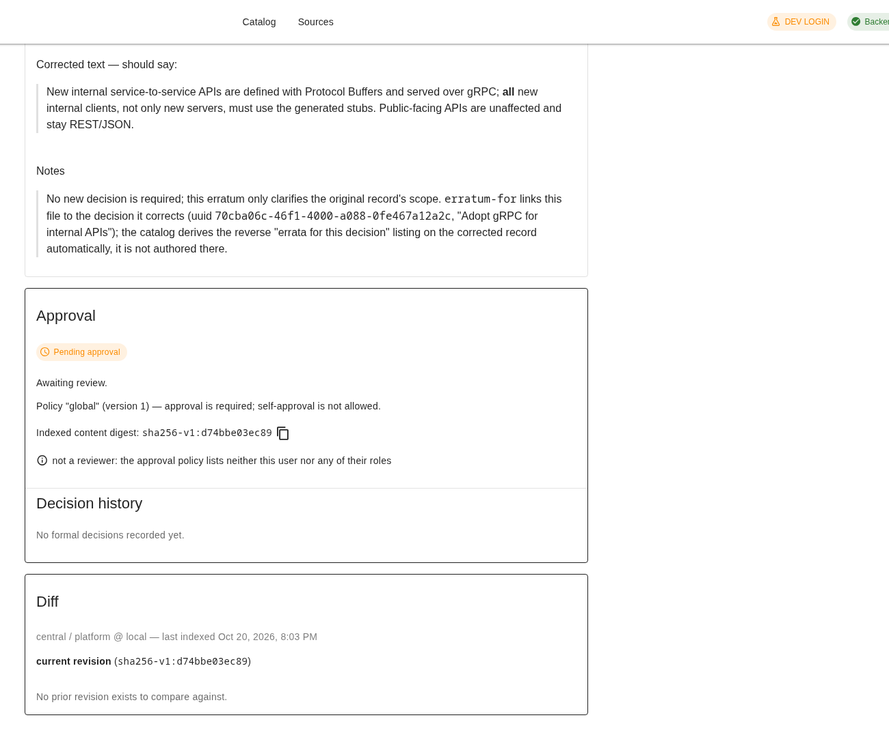

**R-02 — "Pending approval" on records that cannot be approved**
(severity 3, effort M)
- **Principle:** N1, N2.
- **Evidence:** Invalid records (bad YAML, invalid UUID) show "Pending
  approval" in search, in the sidebar and in the approval card, while the
  card also says "this content cannot be decided".
- **Source:** `utils/labels.ts` (`approvalStateLabel`,
  `displayStatusLabel`), `ApprovalCard.vue`.
- **Fix:** Derive a "Blocked — fix validation errors" status, using a
  neutral chip with an error icon, whenever the decide-blocker reason is a
  content problem.

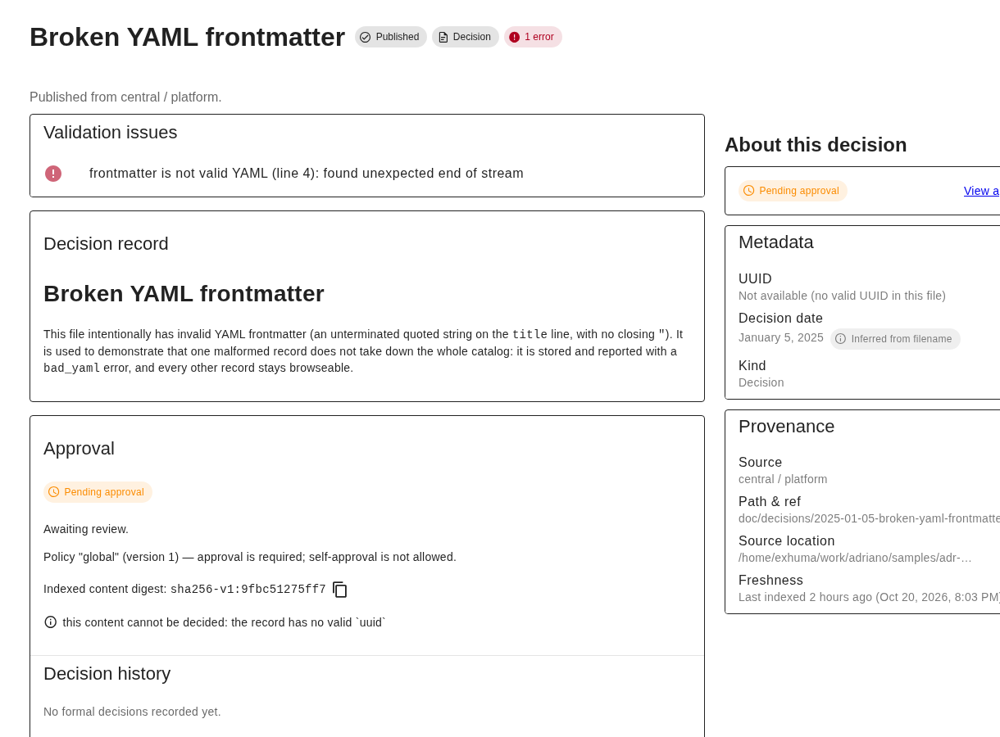

**R-03 — Title shown three times** (severity 2, effort S)
- **Principle:** N8.
- **Evidence:** The page h1, then the card title "Decision record", then the
  markdown's own h1 with the same title.
- **Source:** `record/RecordDecisionCard.vue:18`.
- **Fix:** Drop the card title, and skip the first markdown h1 when it
  matches the record title.

**R-04 — Banner stack repeats and over-alarms** (severity 2, effort M)
- **Principle:** N8, colour semantics.
- **Evidence:**
  - "This decision is obsolete" uses the `error` colour, though being
    obsolete is a lifecycle state, not a fault.
  - The errata banner repeats the Errata section that follows the body.
  - The "Referenced by → Obsoleted by" card repeats the obsolete banner.
  - In the worst case, six alerts stack before any content (code audit).
- **Source:** `record/RecordStatusBanners.vue:109-157`,
  `RecordFreshnessBanner.vue`.
- **Fix:**
  - Keep a single lifecycle notice, neutral or warning with an icon.
  - Turn the errata banner into a link in the header metadata line
    ("1 erratum · View").
  - Keep alerts only for things the reader has to act on or be warned
    about (stale data, digest changed).

**R-05 — Loose header** (severity 2, effort S)
- **Principle:** alignment, N8.
- **Evidence:**
  - There is a 50–70 px gap between the h1 row and "Published from …".
  - The "Published" and "Decision" chips next to the h1 add little, since
    the kind is already in the sidebar and Published is the default.
- **Source:** `record/RecordHeader.vue:42-66`.
- **Fix:** Close the gap, and show only non-default state chips.

**R-06 — Sidebar top misaligned with the main column** (severity 2,
effort S)
- **Principle:** alignment.
- **Evidence:** The first main card starts at y=343 (1920). The sidebar
  heading starts at 377 and its first card at 402.
- **Fix:** Start both columns on the same top line, with the sidebar
  heading inside or above at zero offset.

**R-07 — Body typography inconsistent and lines too long** (severity 2,
effort S)
- **Principle:** readability, S1.
- **Evidence:**
  - Markdown paragraphs are 14 px, while erratum quote blocks next to them
    are 16 px.
  - The main column is about 740 px wide, which gives roughly 105
    characters per line at 14 px. The target is 60–80.
- **Fix:** Use 16 px body text for record prose, and set the prose
  `max-width` to about 70ch.

**R-08 — Empty-value cards shown** (severity 1, effort S)
- **Principle:** N8.
- **Evidence:** A full "Diff" card says only "No prior revision exists to
  compare against."
- **Fix:** Hide the Diff card when there is no prior revision; one line in
  the sidebar's revisions section is enough.

**R-09 — Truncated values with no way to read them** (severity 2,
effort S)
- **Principle:** N6, SC 1.4.10.
- **Evidence:**
  - "Path & ref" and "Source location" are cut with an ellipsis, with no
    tooltip, wrap or copy button.
  - Validation issue text is cut at one line ("`kind` is no longer used: …
    Remove `kind: de…").
- **Source:** `record/RecordProvenanceCard.vue:31,37`,
  `record/RecordIssuesList.vue`.
- **Fix:** Let the text wrap (`word-break: break-word`) and add a copy
  button for the path.

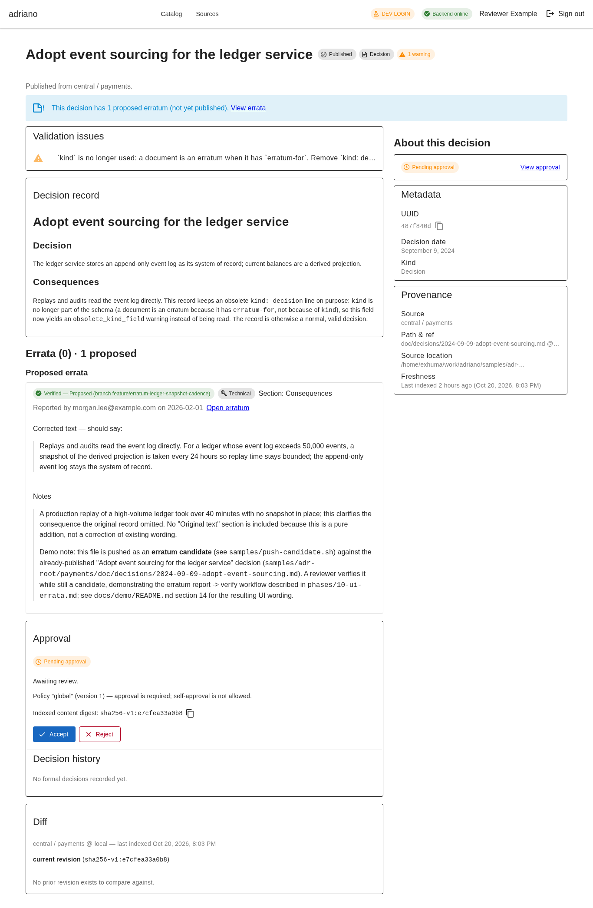

**R-10 — Machine-worded messages** (severity 2, effort M)
- **Principle:** N2, N9.
- **Evidence:** These are shown verbatim:
  - "not a reviewer: the approval policy lists neither this user nor any of
    their roles"
  - "this content cannot be decided: the record has no valid \`uuid\`"
  - "token_env: GitLab token env var ADRIANO_… is not set" (also shown to
    readers)
- **Fix:**
  - Map each reason code to human copy in `utils/labels.ts`.
  - For readers, a muted "Only reviewers can approve" is enough.

**R-11 — Erratum page repeats its status** (severity 1, effort S)
- **Principle:** N8.
- **Evidence:**
  - "Reported" appears three times (banner chip, sidebar, approval card).
  - "Section: Decision" appears twice (subtitle and the card's first line).

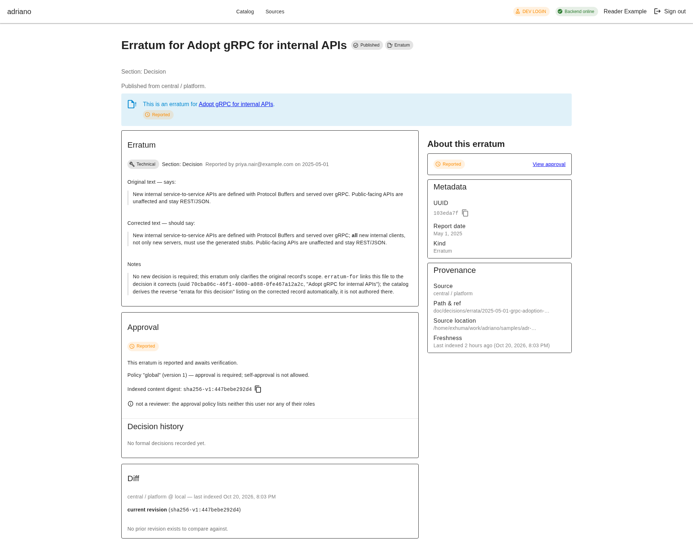

**R-12 — Raw identifiers as primary content** (severity 2, effort S)
- **Principle:** ux kit `technical-identifiers`, N6.
- **Evidence:**
  - The decision dialog's main content is the full 64-hex digest.
  - `RecordLinksCard` falls back to full UUIDs with no copy button.
- **Source:** `DecisionDialog.vue:125`, `RecordLinksCard.vue:35-44`.
- **Fix:** Show the short form with copy, and put the full value behind a
  "Show full digest" disclosure.

**R-13 — Confusing errata count** (severity 1, effort S)
- **Evidence:** "Errata (0) · 1 proposed".
- **Fix:** "Errata — 1 proposed"; omit "(0)".

## Dialogs

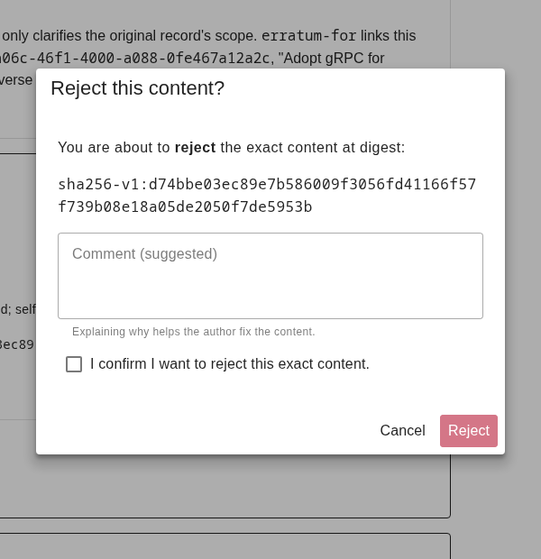

**D-01 — Dialogs have no accessible name** (severity 2, effort S)
- **Principle:** SC 4.1.2.
- **Evidence:** The accessibility tree shows an unnamed `dialog` for Accept,
  Reject and Dev sign-in, because the title is a `v-card-title` `div` with
  no `aria-labelledby`.
- **Source:** `DecisionDialog.vue:112-118`, `DevLoginDialog.vue:111-117`.
- **Fix:** Set `aria-labelledby` to the title id, and render the title as a
  heading.

**D-02 — Dialog doesn't say which record** (severity 2, effort S)
- **Principle:** S8, N6.
- **Evidence:** "You are about to reject the exact content at digest:
  sha256-v1:d74b…" (64 hex characters). The record title is not shown.
- **Fix:** "Reject *Adopt gRPC for internal APIs*?", followed by the short
  digest with copy and a disclosure for the full value.

**D-03 — Title and body indents differ** (severity 1, effort S)
- **Evidence:** The title text starts 8 px left of the body text (16 px vs
  24 px padding).
- **Fix:** Use the same horizontal padding.

**D-04 — Dev-login presets don't match the local catalog** (severity 2 for
developers, effort S)
- **Evidence:** The presets send `reader` / `adr-reviewer`. The local
  `catalog.yaml` maps `admin` and `adr-reader`, so the Reviewer preset gets
  "No access" (403).
- **Source:** `DevLoginDialog.vue:28-30`.
- **Decision (2026-10-20):** derive the presets from the loaded catalog
  through a dev-only endpoint.

Focus behaviour works:

- Escape returns focus to Accept, and Cancel returns it to Reject.
- Reject stays disabled until the confirmation box is ticked.

## Sources

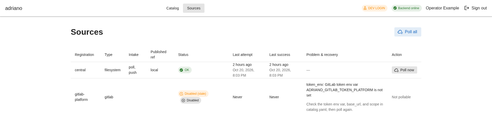

**O-01 — Two status chips for one state** (severity 2, effort S)
- **Principle:** N8, N4.
- **Evidence:** One row shows "Disabled (stale)" (orange, failing contrast)
  and also "Disabled" (grey).
- **Source:** `SourcesView.vue`, `SourceProblemCell.vue`,
  `labels.ts:pollStatusLabel`.
- **Fix:** One chip, "Disabled". Show staleness as secondary text.

**O-02 — Small row action** (severity 2, effort S)
- **Principle:** Fitts's law.
- **Evidence:** "Poll now" is 99×28 px, grey tonal, in the last column.
  "Poll all" is a default-size tonal button at the top right.
- **Source:** `SourcesView.vue:219-229,300`.
- **Fix:** Use the default size (36 px) and `primary` text/tonal for the row
  action.

**O-03 — Key column clipped at 200% zoom** (severity 2, effort M)
- **Principle:** SC 1.4.10.
- **Evidence:**
  - At 200% zoom the page itself doesn't scroll sideways, but the table
    scrolls inside its own container with no visual cue.
  - "Problem & recovery", the column an operator needs most, is the one off
    screen.
  - Dates wrap to three lines.

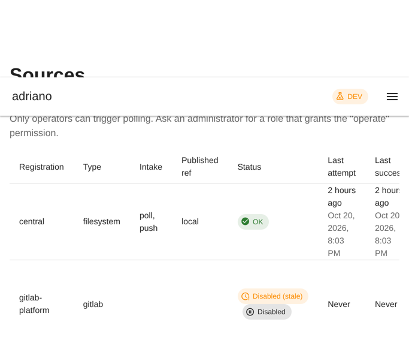

- **Fix:**
  - Move "Problem & recovery" next to Status, or render it as a full-width
    sub-row under a failing source.
  - Show the relative date with the absolute date in a tooltip.

**O-04 — Reader-facing operator detail** (severity 1, effort S)
- **Principle:** N8.
- **Evidence:**
  - Readers see "Only operators can trigger polling…" as the first content
    on the page.
  - They also see env-var names in the problem column.
- **Fix:** Shrink the hint to an info line below the table.
- **Decision (2026-10-20):** readers see status and dates only; env-var and
  recovery detail is for `operate` only.

**O-05 — Table header weight** (severity 1, effort S)
- **Evidence:** Header cells use the same weight as data cells.
- **Fix:** Use medium weight with medium-emphasis colour.

## Prominence audit

| Element | Current weight | Verdict | Treatment |
|---|---|---|---|
| "Backend online" chip | green chip, every page | hide | show only when degraded or offline (G-04) |
| "DEV LOGIN" chip | amber, failing contrast | demote | neutral outlined chip, still persistent (G-04) |
| "Published" chip (search, header) | grey chip, every row | hide | only show non-default states (S-02, R-05) |
| "Pending approval" chip | orange, every row | demote | neutral text or icon; Needs-approval filter and count (S-02) |
| "Decision" kind chip (header) | grey chip | hide | already in the sidebar Metadata (R-05) |
| Long branch chips | 300+ px chips | demote | short chip plus metadata text (S-05) |
| Obsolete banner | red error alert | demote | neutral or warning lifecycle notice (R-04) |
| Errata banner | blue alert | demote | header meta link (R-04) |
| "Decision record" card title | card title above duplicate h1 | hide | (R-03) |
| Diff card with no prior revision | full card | hide | (R-08) |
| Full digest in dialog | 2-line monospace | demote | short plus disclosure (D-02, R-12) |
| Permission hint on Sources | first content line | demote | info line below the table (O-04) |
| Needs-approval switch hint | 2-line text in the filter bar | demote | tooltip (S-03) |
| Card outlines | black 1 px on every card | demote | low-emphasis border (G-07) |
| Accept / Reject | far below the fold | promote | sticky sidebar (R-01) |
| Issue chips (error/warning) | drowned in orange | promote | sole strong colour on rows (S-02) |

## Strengths to keep

- Whole-row links in search give large Fitts targets (about 1368×73 px at
  1920).
- The skip link comes first and works. Focus returns to the trigger after
  dialogs, and there are no keyboard traps.
- Reject needs an explicit confirmation; Accept shows the exact digest.
- Filters stay in sync with the URL, and a live region announces result
  counts.
- No page-level horizontal scroll at 200% zoom, and the sidebar stacks
  under the body.
- Short IDs with copy buttons (`ShortIdCopy`), and no hard-coded colours in
  components.
- The dark-theme tokens pass contrast.
- No console errors, apart from Vite's dependency-optimisation reloads in
  dev.

## Notes outside the UI

- In dev, a Vite dependency-optimisation reload drops the dev-login session,
  which is kept in memory. This only affects development; it was not checked
  for OIDC.

## After (phase 11)

Re-run of the Method above against the phase 11 build, 2026-10-21, same
local dev servers (backend 8100, Vite 5173, restarted fresh for this run)
and the same test database (17 records, 2 sources, 1 decision event).
Roles and viewports match the original method; dark mode used
`colorScheme: 'dark'` with no stored preference, plus a second pass with a
stored `"light"` preference. No decision, poll, or candidate push was
submitted.

Tooling: the session scratchpad's `measure.js` does not composite
Vuetify's 12%-opacity tonal underlay (`.v-chip__underlay`,
`.v-alert__underlay`) or ancestor CSS `opacity` (medium-emphasis text). A
copy, `measure2.js`, adds both: it multiplies the underlay's own
`opacity` into its background colour before compositing, and multiplies
cumulative ancestor `opacity` into the text colour's alpha before mixing.
Re-measuring with the corrected script changed several apparent
near-black/zero-ratio false positives (caused by the uncomposited
underlay) to their real values.

### Playwright verification checklist

| Check | Result | Numbers |
|---|---|---|
| Alignment: app-bar brand == container at 1366/1920/2560 | pass | edges equal (3px / 280px / 600px) on `/`, a record, `/sources` |
| Alignment: container left edge identical across routes | pass | same value per width on all 3 routes |
| Targets: no interactive target under 24x24 | pass | 3 violations found and fixed, see "New issues" |
| Targets: Accept/Reject visible without scrolling at 1366x768 | pass | sidebar Accept inside the 1366x768 viewport |
| Contrast: light theme, composited, 4.5:1 / 3:1 large | pass | 0 low-contrast nodes on `/`, `/sources`, a record |
| Contrast: dark theme, composited | pass | 1 violation (link text, 4.14:1) found and fixed, see "New issues" |
| Keyboard: skip link first | pass | "Skip to main content" is tab stop 1 |
| Keyboard: visible focus indicator on every control | pass | outline on links/buttons, `v-field--focused` border on inputs |
| Keyboard: no static content is a tab stop | pass | Provenance list is `<v-list tabindex="-1">` |
| Keyboard: Escape/Cancel return focus to the trigger | pass | sidebar and main-column Accept/Reject, 4 of 4 combinations |
| Theme: OS dark, no stored preference, dark applied | pass | |
| Theme: stored "light" overrides OS dark | pass | |
| Zoom 683x384 DPR2: no page-level horizontal scroll | pass | sources and a record |
| Zoom: Sources problem detail visible without table scroll | pass | table not horizontally scrollable |
| Zoom: record sidebar stacks below main | pass | main top 271px, sidebar top 1112px |
| Search: Recently changed puts newest-updated record first | pass | matches `order by updated_at desc` query |
| Search: typing a query switches sort to Relevance | pass | sort control reads "Relevance" after typing |
| Dev sign-in: each preset, 5 runs, no 403 | pass | reader/reviewer/operator, 0/5 failures each |
| Console: no errors (ignoring Vite reloads) | pass | 0 at 1366, 1920 and 2560 |
| Database row counts unchanged | pass | see table below |

Dev sign-in was re-verified only against the running servers'
`catalog.yaml`; `catalog.demo.yaml` needs its own backend/frontend stack,
out of scope for a re-verification task that must not start `task dev`.
Task 10's own tests (`test_dev_roles.py`, preset-derivation tests) cover
`catalog.demo.yaml`.

### Database row counts

| Table | Before | After |
|---|---|---|
| record | 17 | 17 |
| revision | 17 | 17 |
| decision_event | 1 | 1 |
| intake_run | 2 | 2 |
| source_registration | 2 | 2 |

No decision was submitted, no poll was triggered, and no candidate was
pushed during this task.

### Before/after screenshots

Curated `after-*` images sit next to their numbered counterparts in this
directory.

| Before | After | What changed |
|---|---|---|
| `01-sign-in.png` | `after-01-sign-in.png` | primary-colour button, health chip hidden |
| `02-search-1920.png` | `after-02-search-1920.png` | inline status, "Published" hidden, sort control |
| `06-record-1920.png` | `after-06-record-1920.png` | sidebar Accept/Reject, single title, aligned columns |
| `07-record-1366.png` | `after-07-record-1366-accept.png` | Accept/Reject reachable without scrolling |
| `08-record-invalid.png` | `after-08-record-blocked.png` | "Blocked" chip instead of "Pending approval" |
| `09-erratum-reader.png` | `after-09-erratum-reader.png` | status shown once, human-worded copy |
| `10-reject-dialog.png` | `after-10-reject-dialog.png` | named dialog, short digest, aligned padding |
| `11-sources-operator.png` | `after-11-sources-operator.png` | one chip, default-size "Poll now", problem sub-row |
| `12-sources-zoom-200.png` | `after-12-sources-zoom-200.png` | problem detail visible, no table scroll |
| `13-record-dark.png` | `after-13-record-dark.png` | reachable dark theme, single-surface cards |
| `14-focus-indicators.png` | `after-14-focus-indicators.png` | visible focus ring on copy buttons |
| `15-reader-approval.png` | `after-15-reader-approval.png` | neutral status text, no raw reason codes |

### Finding status (severity 2 and above)

Status legend: **closed** (verified fixed), **partly** (fixed with a
residual gap), **deferred** (not done, with reason). All 29 findings of
severity 2 or more are closed; none were deferred.

| ID | Sev | Status | Evidence |
|---|---|---|---|
| G-01 | 3 | closed | 0 low-contrast chip/alert text, light and dark |
| G-02 | 2 | closed | app-bar title left edge == container left edge |
| G-03 | 2 | closed | container left edge identical across routes |
| G-04 | 2 | closed | health chip hidden while state is `ok`/checking |
| G-05 | 2 | closed | MD3 type scale in place; card titles are headings |
| G-06 | 2 | closed | OS dark applied by default; user menu overrides it |
| G-07 | 2 | closed | one card style: flat, low-emphasis border |
| G-08 | 2 | closed | focus ring/field-focus visible on every sampled control |
| R-01 | 3 | closed | sidebar Accept/Reject in view at 1366x768 |
| R-02 | 3 | closed | "Blocked" chip shown on invalid records |
| R-03 | 2 | closed | record title shown once |
| R-04 | 2 | closed | single lifecycle/freshness notice, not error-red |
| R-05 | 2 | closed | tight header, only non-default chips |
| R-06 | 2 | closed | main and sidebar columns share a top line |
| R-07 | 2 | closed | capped prose width, one body size |
| R-09 | 2 | closed | wrapped values, copy buttons on path/UUID/digest |
| R-10 | 2 | closed | human-worded approval and policy copy |
| R-12 | 2 | closed | short UUID/digest with a "Show full digest" disclosure |
| S-01 | 3 | closed | status inline on the row's second line, left-aligned |
| S-02 | 3 | closed | "Published" and other default-state chips hidden |
| S-03 | 2 | closed | one filter-bar density; hint moved to a tooltip |
| S-04 | 2 | closed | closable filter chip, count line, neutral switch colour |
| S-05 | 2 | closed | short chip text, branch moved to metadata text |
| D-01 | 2 | closed | dialog titled as a heading, `aria-labelledby` |
| D-02 | 2 | closed | dialog names the record ("Reject “Title”?") |
| D-04 | 2 | closed | 0 of 5 sign-ins per preset returned 403 |
| O-01 | 2 | closed | one status chip per row, staleness as secondary text |
| O-02 | 2 | closed | default-size "Poll now" |
| O-03 | 2 | closed | problem detail visible at 200% zoom, table doesn't scroll |

### New issues found

Found during the Task 14 re-verification; none were in scope for any
Phase 11 task. All three are **fixed** as a Task 16 follow-up (this
task) and re-verified live, in light and dark at 1366 and 1920, on:

- `/records/6285cf4a-2da5-4202-b50b-47322b90bfa3` ("Adopt gRPC for
  internal APIs"; its one inbound link is consumed by the lifecycle
  notice, so the "Add a REST gateway in front of gRPC services"
  record's resolved *outbound* link to it is what actually exercises
  `RecordLinksCard`'s "Related decisions" card)
- `/records/bbf9b991-54b5-417a-b3e3-1fde9487fbc8`
- `/sources`

Result: zero contrast violations, zero non-inline targets under 24px.

1. **Sidebar link targets under 24px tall** (severity 2, effort S) --
   **fixed**. `RecordLinksCard`/`RecordSiblingsCard` rendered outbound,
   inbound and sibling links as a plain `<a>` inside
   `v-list-item-subtitle`; the clickable box was only the text's own
   line height (measured 186x16 at 1366, light theme, for a "Related
   decisions"/"Obsoletes" link). This is a navigational link in a
   metadata list, not prose inside a sentence, so the SC 2.5.8 inline
   exception did not apply. Fix: `d-inline-block py-1` on each link
   (Vuetify utility classes, ladder step 4); re-measured at 186x28 for
   the same link. The link stays a real `<a>`/`router-link` in the
   list's own tab order (only the `<v-list>` itself is `tabindex="-1"`).
2. **Dark-theme link colour under 4.5:1** (severity 2, effort S) --
   **fixed**. The same link text measured 4.14:1 in the dark theme
   (`rgb(120,120,188)` on `rgb(30,30,30)`, 14px body text) -- just under
   the 4.5:1 requirement, and the same browser-default colour (incl.
   `:visited`) affected every other plain `<a>`/unstyled `router-link`
   in the app (the "View errata" anchor, `RecordStatusBanners`'
   lifecycle/erratum links, `ErratumEntry`'s "open the erratum" link,
   `DivergenceBanner`'s links, and server-rendered markdown links
   inside `.rendered-markdown`/`.erratum-block-body`). G-01 fixed chip
   and alert colours but not the plain anchor colour. Fix: Vuetify's
   own `text-primary` utility class (ladder step 4) on each affected
   `router-link`/`<a>`, and a scoped `:deep(a) { color:
   rgb(var(--v-theme-primary)) }` rule (ladder step 6, justified: a
   markdown link rendered via `v-html` has no class hook) for the two
   markdown-body cases. `RecordLinksCard`'s links additionally needed
   `--v-list-item-subtitle-opacity: 1` inline on their
   `v-list-item-subtitle`, since that element's medium-emphasis
   `opacity` composites its whole subtree (not a `color-mix` a
   descendant's own `color` could simply override) and would otherwise
   have refaded `text-primary` back under 4.5:1 in light (measured
   2.92:1 before the override). Re-measured: light primary `#1867C0` on
   white is 5.61:1; dark primary `#90CAF9` is 9.53:1 on `#1E1E1E`
   surface, 10.71:1 on `#121212` background; both also clear 4.5:1
   against the warning/info tonal tints the alert-embedded links sit
   on (4.72-4.74:1 light, 7.37-7.57:1 dark) -- all covered by new
   `tests/plugins/vuetify.test.ts` cases. A blanket, unscoped
   `a, a:visited { color: ... }` rule was tried first and reverted: all
   of Vuetify's own CSS (components and utilities alike) lives inside
   `@layer`, and an unlayered author rule always outranks a layered one
   regardless of specificity -- it recoloured every `v-btn`/`v-list-item`
   rendered as an anchor (e.g. the app-bar "Catalog" nav button) to
   primary, which per-element `text-primary` does not.
3. **Sources relative-date tooltip targets under 24px tall** (severity
   1, effort S) -- **fixed**. The O-03 fix's relative-date tooltip
   trigger (e.g. "10 hours ago") measured 82x16 and is
   keyboard-focusable. Lower severity since it is a supplementary
   tooltip, not a navigation or decision action. Fix: `d-inline-block
   py-1` on the trigger span; re-measured at 82x29.
